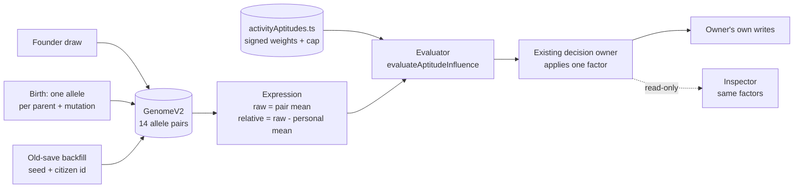

# Wilderfolk — DNA aptitudes architecture

**Status:** implemented 6 November 2026. **Design source:** [Genetic aptitudes and personality overhaul](plans/genetic-aptitudes-personality-overhaul-2026-11-02.md) (PR #124). **Ownership register:** [OWNERSHIP_OVERVIEW.md](../OWNERSHIP_OVERVIEW.md) · **Decision table:** [decisionRegistry.ts](../src/game/simulation/decisionRegistry.ts).

This document describes what the live code does, not the proposal. It is the reference for changing genetics weights, adding an activity, or reviewing a genetics-adjacent pull request.

---

## 1. One-paragraph summary

Every living player settler carries one immutable `GenomeV2`: fourteen inherited aptitude dimensions, each stored as two alleles. Expression is the mean of the two alleles; gameplay uses each dimension's deviation from that settler's own fourteen-dimension mean. One static registry maps a typed activity to signed weights; one pure evaluator turns a genome and an activity into a single bounded factor (`1 ± cap`). The existing decision owner applies that factor to its own baseline and keeps sole write authority. Conception reads no genetics. Four **personal marks** — lucky, pretty, scarred and sickly — are born or earned, never inherited, and enter the same evaluator through the same activity records. The inspector reads the same evaluator; there is no UI-side scoring rule.

---

## 2. Layer map



There is no second pipeline. Allocation, inheritance, backfill and expression live in `settlerTraits.ts`; activity data lives in `personality/activityAptitudes.ts`; the only computation lives in `personality/traitEvaluation.ts`; every consumer is an existing owner.

---

## 3. Data model

```ts
const APTITUDE_IDS = [
  'sociability', 'sensitivity', 'cooperation', 'curiosity',
  'persistence', 'flexibility', 'patience', 'riskTaking',
  'perception', 'initiative', 'composure', 'discipline',
  'reasoning', 'creativity',
] as const;

interface GenomeV2 {
  readonly version: 2;
  readonly aptitudeAlleles: readonly (readonly [number, number])[]; // exactly 14, fixed order
}
```

| Rule | Value / behaviour |
| --- | --- |
| Allele bounds | integer `0..100` |
| Pair count | exactly 14, order fixed by `APTITUDE_IDS` |
| Founder draw band | `20..80` per allele |
| Old-save backfill band | `35..65` per allele |
| Birth mutation | 2% per inherited allele, step `1..4`, clamped |
| Minimum expression spread | 10 points between highest and lowest raw value |
| Validation | version 2, exactly two object keys, 14 valid pairs; otherwise rejected |
| Immutability | genome, pairs and expression projections are frozen |
| Storage | `Entity.genomeV2`, persisted in `ENTITY_PERSISTED_FIELDS` |
| Personal marks | `Entity.marks`: born or earned once, never inherited, validated on load |

`normalizeGenome` is the only untrusted-input boundary. A valid saved genome is kept as written; an invalid or absent one is replaced by `genomeFromSeed(colonySeed, entityId)`, which never draws from a live stream. The retired categorical `traits` field is deleted on load and is never read by gameplay.

### Expression

- `raw[i] = (allele0 + allele1) / 2`
- `personalMean = mean(raw)`
- `relative[i] = raw[i] - personalMean`

Personal-mean centering is what prevents a settler with universally high raw values from being universally good: only the *shape* of the profile matters. Expression is computed on demand; nothing caches a modifier.

---

## 4. Lifecycle

| Event | Function | Behaviour |
| --- | --- | --- |
| Founder creation | `entityFactory.createEntity` → `rollFounderGenome` | Draws 14 pairs from the live `settlerGenetics` stream for a player settler only, then enforces spread; a foreign faction is created neutral. |
| Birth | `humanLifecycle.tickPregnancyAndBirth` → `inheritGenome` | Picks one allele per parent per dimension, applies the rare bounded mutation, enforces spread. Biological father only. |
| Old save | `saveLoad.backfillLegacySettlerDNA` → `normalizeGenome` / `genomeFromSeed` | Valid genome kept; otherwise deterministic per colony seed and citizen id. Runs after the RNG registry is restored. |
| Worker prep | `simPrep.extractSimPrep` / `applySimPrep` | Copies `genomeV2` with the entity; never rerolls. |
| Worker delta | `simDelta.PROFILE_FIELDS` | Ships the genome once and on profile refresh; no per-tick payload. |
| Moon Howler | `moonHowler.transformToWerewolfForm` / `moonHowlerForm.revertToHumanForm` | The same entity keeps the same genome through both forms. |
| Dead / foreign | — | No genome is created or read; behaviour falls back to neutral. |
| Personal marks | `entityFactory.createEntity` → `rollBornMarks`; `frontierCombat.resolveIncomingRaidCasualties` and `blueberryForaging.tryTickBlueberryForaging` → `grantMark` | Born marks draw once at creation for a player settler; an earned mark needs a real resolved event and its definition's own source; a parent passes neither. |

No recurring genome roll exists. RNG draws happen only at founder creation, birth and the one creation-time mark draw; no mark is ever rerolled.

---

## 5. Activity registry

`APTITUDE_ACTIVITIES` is the single signed weight table. `cap` is the maximum relative change; `cost: true` means the factor multiplies an *unwanted* chance, so a low factor is good for the settler.

| Activity | Cap | Cost? | Applied by | Effect on owner baseline |
| --- | ---: | :---: | --- | --- |
| `friendship` | 15% | — | `relationships.advanceSocialRelationships` → `bumpFriendship` | Shared friendship gain |
| `reconciliation` | 15% | — | same daily pass → feud decay | Daily feud reduction |
| `conflict` | 12% | yes | same daily pass → `driftIntoFeud` | Daily pair feud chance |
| `learning` | 18% | — | `education.creditChildSchoolDay` | Class ticks needed for one school day |
| `research` | 15% | — | `education.getEducationResearchMultiplier` | Colony research multiplier |
| `apprenticeshipTraining` | 15% | — | `apprenticeships.advanceApprenticeships` → `teach` | Daily trade-skill gain |
| `routineWork` | 15% | — | `skills.getWorkerSkillMultiplier` (production) | Crew production multiplier |
| `construction` | 18% | — | `skills.getWorkerSkillMultiplier` (construction) | Build-crew progress multiplier |
| `labor` | 15% | — | `humanPhysiology.advanceHumanNeeds` | Divisor on shift stamina drain |
| `hunting` | 15% | — | `humanHuntingBehavior.tickHumanHunting` | Hunt reach |
| `pursuit` | 12% | — | same hunt path | Closing speed on prey |
| `escape` | 15% | — | `humanTick.tickHumans` | Flee speed from a threat |
| `defense` | 15% | — | `militiaBalance.computeMilitiaBreakdown` | Each mustered soldier's contribution |
| `courtship` | 15% | — | `humanTick.tickHumans` | Courtship progress rate (pair average) |
| `company` | 12% | — | `socialLife.tryWorkplaceBanter` | Coworker banter chance |
| `bereavement` | 15% | — | `humanLifecycleCleanup.finalizeHumanDeath` | Grief recovery speed (day divisor) |
| `communityReaction` | 15% | — | `raidAftermath.applyWarCommunityReaction` | Civic restraint / severity voice band |
| `conception` | 10% | — | `humanRelationships.tryDailyConception` | Married/youth/affair conception chance — no aptitude weights; the activity`s mark factor applies on all three routes |

`APTITUDE_ACTIVITY_OWNERS` names the one source file each activity is wired through; the coverage test reads those files and fails if an activity id disappears from its owner.

### Personal marks

Marks are not alleles. Each is born once (`pretty` 12%, `sickly` 8%, one draw each on the `settlerMarks` stream) or earned once from a resolved event, and a parent never passes one to a child. `grantMark` is the only writer and is idempotent per id, so a replayed event cannot duplicate or stack a mark.

| Mark | Born? | Earned from | Priced on |
| --- | :---: | --- | --- |
| `lucky` | — | Repelled raid survived; emptied rare bush | hunting, pursuit, escape, defense, conception |
| `pretty` | yes | — | courtship, friendship, company |
| `scarred` | — | A mauling survived | defense up, courtship down |
| `sickly` | yes | — | labor, escape, construction, defense down |

A mark contributes only to the activities listed in `APTITUDE_ACTIVITIES[activity].marks`; everywhere else it is exactly neutral. The `conception` activity has no aptitude weights, so an acquired lucky mark is the only thing that can move it — conception stays genetically blind.

### Per-dimension up/down coverage

Every dimension has at least one positive and one negative weight in the registry, and both sides are reachable through the owner table above.

| Dimension | Up in | Down in |
| --- | --- | --- |
| Sociability | friendship, courtship, company | routine work |
| Sensitivity | friendship, courtship, company, civic voice | labour, bereavement |
| Cooperation | friendship, reconciliation, fewer feuds, civic voice | defence |
| Curiosity | learning, research, apprenticeship | routine work |
| Persistence | learning, research, training, routine work, construction, labour, pursuit, grief recovery | reconciliation, escape |
| Flexibility | reconciliation, fewer feuds, company, grief recovery, civic voice | learning, training, routine work |
| Patience | reconciliation, fewer feuds, hunting, defence, courtship | pursuit, escape |
| Risk-taking | hunting, pursuit, defence | feuds, escape, civic mercy |
| Perception | hunting, pursuit, escape, courtship | company |
| Initiative | construction, courtship | routine work |
| Composure | labour, escape, defence, grief recovery | friendship, feuds, company |
| Discipline | learning, training, routine work, labour, defence, civic voice | construction |
| Reasoning | research, construction | hunting, pursuit, escape |
| Creativity | research, construction | routine work |

Where PR #124 suggested an owner that does not exist as a live mechanic (solitude recovery, dedicated parenting care), the dimension's downside was attached to an existing live activity instead of inventing a new decision.

---

## 6. Evaluator contract

For settler `p`, activity `A`, signed weights `w_i`, relative expression `d_i`, carried mark weights `m_k`, and cap `c(A)`:

```text
weighted = Σ w_i · d_i
score    = clamp(weighted / (50 · Σ|w_i|) + Σ m_k [mark carried], -1, +1)
factor   = 1 + c(A) · score
```

- `m_k` is the signed mark weight in the same activity record. A mark counts only while the settler carries it, so a settler with no marks produces exactly the genome-only result; an activity with no aptitude weights (`conception`) is scored from marks alone.
- The result is one object `{ factor, score, reasons? }`; owners apply `factor` once to their own baseline.
- `includeReasons` is opt-in. Each reason names the aptitude, signed weight, relative value, stable `effectId` (`activity.aptitude`) and whether it is a benefit or drawback for that activity.
- Exactly-zero weighted sum: the first relevant non-neutral dimension in declared weight order decides the sign, with a documented minimum ±0.5% impact. No hash and no extra roll.
- A neutral/no-genome subject returns `{ factor: 1, score: 0 }`.
- Two-person actions use `combinePairFactors(a, b) = (a + b) / 2` in the existing pair owner. Eligibility, consent, reciprocity, caps and RNG draws stay there.
- The evaluator reads no `WorldState`, clock or RNG and writes nothing.

---

## 7. Persistence and transport

| Boundary | Owner | Rule |
| --- | --- | --- |
| Save allow-list | `saveSchema.ENTITY_PERSISTED_FIELDS` | `genomeV2` and `marks` are entity-persisted fields. |
| Load | `saveLoad.backfillLegacySettlerDNA` + `personalMarks.normalizeMarks` | Validate or backfill the genome once; drop retired `traits`; validate or drop marks without inventing one; no live RNG draw. |
| Worker prep | `simWorker/simPrep.ts` | Copy `genomeV2` and `marks` with the entity. |
| Worker delta | `simBuffers/simDelta.ts` | `genomeV2` and `marks` are profile fields, not per-tick fields. |
| Moon Howler | `moonHowler*.ts` | Transform and revert never touch the genome. |
| Save round-trip | `tests/personality.legacyDNA.test.ts` | Double-load idempotence and Moon-form preservation. |

---

## 8. Inspection

`components/PersonalityCareerDetails.tsx` renders, read-only, for a living player settler:

1. all fourteen aptitudes with raw values;
2. three strongest positive and three strongest negative deviations as derived highlight descriptors;
3. every activity whose factor differs from neutral by at least 1%, rendered with the same `evaluateAllAptitudeActivities` result the simulation uses;
4. advisory job fit from `evaluateWorkerFit` with reasons;
5. saved career history and milestones.

`SelectedEntityPanel` shows three derived highlight chips. The inspector never scores, caches or writes anything.

---

## 9. Deliberately absent

- No inherited Lucky locus, `luckyAlleles`, inherited luck bonus, or personality-linked conception modifier. The `lucky` **mark** is acquired from a resolved event, is never inherited and never rerolled.
- No second genetics source: the retired three-label `traits` field is deleted on load.
- No persisted or cached per-activity modifier, no `aptitudeScores`, no parallel `geneticsManager`.
- No private weight table in an owner; all weights live in `activityAptitudes.ts`.
- No new tick loop, no extra chance roll for genetics, no population scan, no automatic job shuffle.
- No UI-side scoring rules and no mystery inspector-only effects.
- No breeding-for-perfection: personal-mean centering plus the guaranteed spread means every settler has strengths and weaknesses.

---

## 10. Function ownership registration

Every new production function has one owning module in [OWNERSHIP_OVERVIEW.md](../OWNERSHIP_OVERVIEW.md). The evaluator and worker-fit decisions are also registered in [decisionRegistry.ts](../src/game/simulation/decisionRegistry.ts); conception and birth rows explicitly describe the non-genetic and inheritance boundaries.

| Module | Public entry points | Internal helpers (same owner only) |
| --- | --- | --- |
| `settlerTraits.ts` | `rollFounderGenome`, `inheritGenome`, `genomeFromSeed`, `establishCitizenIdentity`, `normalizeGenome`, `expressAptitudes`, `aptitudeMean`, `genomeOf` | `clampAllele`, `meanOfPair`, `drawGenome`, `ensureSpread`, `buildGenome`, `mutated` |
| `personality/activityAptitudes.ts` | data: `APTITUDE_ACTIVITIES`, `APTITUDE_ACTIVITY_IDS`, `APTITUDE_ACTIVITY_OWNERS` | — |
| `personalMarks.ts` | `rollBornMarks`, `grantMark`, `normalizeMarks`, `marksOf`, `hasMark`, `isPersonalMarkId`, `awardRaidSurvivalMark`, `awardRareWindfallMark`, data: `PERSONAL_MARK_IDS`, `PERSONAL_MARK_DEFS` | — |
| `personality/traitEvaluation.ts` | `evaluateAptitudeInfluence`, `combinePairFactors`, `evaluateAllAptitudeActivities` | `relativeOf`, `markScoreOf`, `directionOf` |
| `careers/workerFit.ts` | `evaluateWorkerFit` | `activityForJob` |
| `components/PersonalityCareerDetails.tsx` | `PersonalityCareerDetails` | `strongest`, `Highlight` |
| `saveLoad.ts` | `backfillLegacySettlerDNA` (existing row) | — |
| `tests/helpers/genome.ts` | test fixture: `genomeFrom`, `high`, `low`, `relativeOf`, `heterozygous` | — |

The build call graph reports zero functions without a recorded owner. The ownership rows name the entry and internal functions so a reviewer can trace each one to exactly one module. The **PR #124 complete-file audit** in [OWNERSHIP_OVERVIEW.md](../OWNERSHIP_OVERVIEW.md) additionally lists every pre-existing named helper in the touched owner files (relationships, education, skills, socialLife, humanRelationships, saveLoad, simPrep, simDelta and the rest) and every test-local helper, so no function is covered only by a module fallback.

---

## 11. Test evidence map

| Claim | Test |
| --- | --- |
| Genome shape, bounds, spread, founder determinism, validation, inheritance, mutation, expression | `tests/settlerTraits.test.ts` |
| Every dimension has an upward and downward weight and both are observable; every activity is wired into its owner; real generated settlers have a buff and a debuff | `tests/personality.activityAptitudes.test.ts` |
| Bounded factor, relative centering, signed directions, cost activity, reasons, tie-break, pair average | `tests/personality.traitEvaluation.test.ts` |
| Work, construction, training, real production/construction days | `tests/personality.workIntegration.test.ts` |
| Learning and research | `tests/personality.educationIntegration.test.ts` |
| Labour drain, walking unaffected | `tests/personality.physiologyIntegration.test.ts` |
| Militia, hunting, pursuit, escape | `tests/personality.defenseIntegration.test.ts` |
| Friendship, feud friction, reconciliation, banter | `tests/personality.socialCompatibility.test.ts` |
| Courtship, non-genetic conception, newborn inheritance | `tests/personality.romanceContext.test.ts` |
| Grief recovery | `tests/personality.familyContext.test.ts` |
| Civic voices | `tests/personality.civicContext.test.ts` |
| Old-save backfill, double-load, Moon form | `tests/personality.legacyDNA.test.ts` |
| Career preservation and old-save migration | `tests/personalityCareer.oldSaveMigration.test.ts` |
| Inspector rendering and no writes | `tests/personalityCareer.inspector.test.ts` |
| No retired categorical consumer can return | `tests/personality.legacyConsumerAudit.test.ts` |
| Worker profile transport | `tests/simDelta.entityProfile.test.ts` |
| Marks: born/earned, idempotent grant, load validation, evaluator pricing, raid and windfall hooks, save round-trip and worker copy | `tests/personalMarks.test.ts` |
| Mark-only conception stays genetically neutral | `tests/personality.activityAptitudes.test.ts` |

---

## 12. Change recipes

### Tune a weight
Edit only `activityAptitudes.ts`; run the coverage and owner-integration tests. Never add a weight table to an owner.

### Add an activity
1. Add its id to `AptitudeActivityId` and a signed profile to `APTITUDE_ACTIVITIES`.
2. Choose a cap (5–20%) and `cost: true` only if the factor multiplies an unwanted chance.
3. Add the id and owner file to `APTITUDE_ACTIVITY_OWNERS`.
4. Wire `evaluateAptitudeInfluence(subject, '<id>')` once in that owner, replacing the owner's own baseline.
5. Add an owner-level test proving a positive and a negative profile change the outcome, and that guards still hold.
6. Update OWNERSHIP_OVERVIEW, decisionRegistry's affected owner row, CHANGELOG and this document.

### Add a personal mark
1. Add the id to `PERSONAL_MARK_IDS` and a `PERSONAL_MARK_DEFS` entry saying whether it is born or earned.
2. Add its signed weight to the activities it should touch in `activityAptitudes.ts`; never give it a global effect.
3. Call `grantMark` (or a named award helper) only at the owner where the real event commits, inside that event's own guard.
4. Extend `tests/personalMarks.test.ts`; a parent never passes a mark to a child and a mark is never rerolled on load.

### Change the dimension set
This is a save-format change: bump `GENOME_VERSION`, add a migration, update `APTITUDE_IDS` order, every activity's weights, the inspector and all tests. Do not append a dimension silently; the order is part of the saved contract.

### Migrate a save
Never reroll genotypes. Use `normalizeGenome` for an existing genome; use `genomeFromSeed` only for a settler with no valid genome. Never read the retired categorical labels.

---

## 13. Related documents

- [Design proposal](plans/genetic-aptitudes-personality-overhaul-2026-11-02.md)
- [Ownership overview](../OWNERSHIP_OVERVIEW.md)
- [Technical architecture](../ARCHITECTURE.md)
- [Changelog](../CHANGELOG.md)
