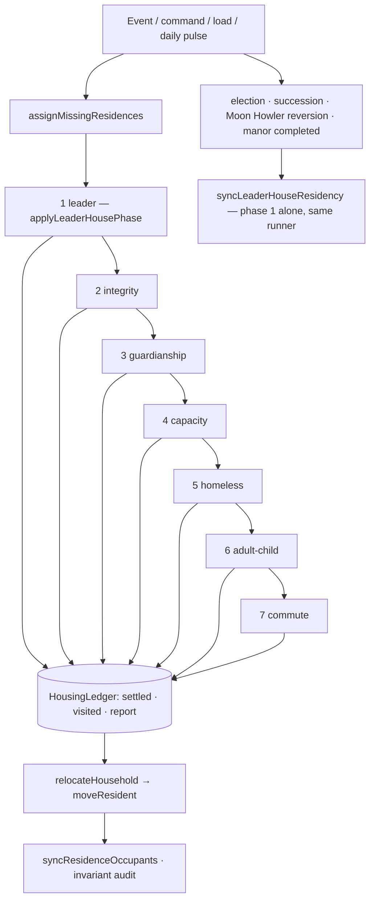
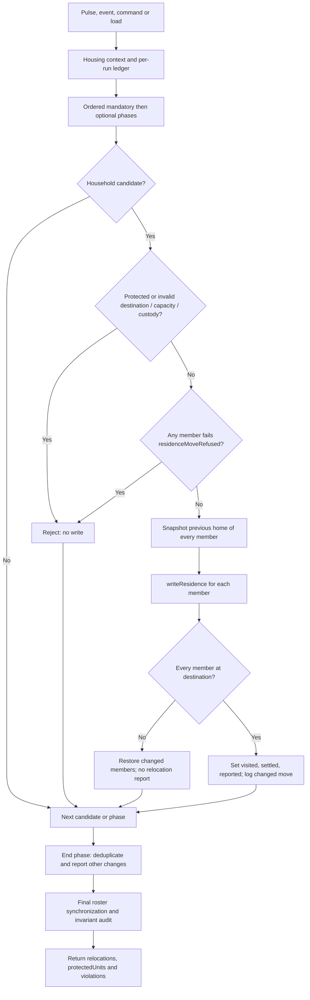

# Housing architecture — one authority, one order

The single reference for how the colony decides **who sleeps where**: the model, the pipeline, the
relocation rules, the decisions the owner confirmed, and what is still open.
Owner module: `src/game/residencyReconciliation.ts`.

This document describes the code as it stands after the 2026-10-25 consolidation. If the two disagree, the
code is right and this file is a bug.

---

## 1. The shape that changed

Before, three engines moved households and none knew the others' intent: placement filled a home that fit,
the nest-leaving sweep moved an adult child into *any* empty home, and the commute trade then traded that
same household's home for a nearer one. Each rule was defensible alone; together they produced move events
that undid each other, and twelve call sites wrote `residenceBuildingId` directly, so no rule could be
reasoned about — or tested — inside the housing module.

Today there is exactly one of each thing that matters:

| Concern | Single owner |
| :--- | :--- |
| **When** housing is decided | `assignMissingResidences` — full seven-phase housing scheduler; `syncLeaderHouseResidency` — immediate leader-only event transition |
| **What was already decided this run** | `HousingLedger` — one per run |
| **How a decision is applied** | `relocateHousehold` for a household, `moveResident` for one settler |
| **Which home a settler should get (pure scoring)** | `residencySelection.ts` |
| **One residence write** | `moveResident` |

No phase function is exported as a scheduler. `tryMoveOutOfFamilyHome`,
`rebalanceAdultChildrenFromFamilyHomeWhenEmptyAvailable`, `rebalanceOvercrowdedResidences` and
`relocateHouseholdsForCommute` are exported only so tests and the benchmark can call them directly; inside
the simulation they run only from `assignMissingResidences`. The manor hold is the one decision a run needs
supplied from outside — `applyLeaderHousePhase` — because its rule lives in `leaderHouse.ts`; the sweep owns
when it runs and hands it the run's ledger.



---

## 2. The phases, in order

`HOUSING_PHASE_ORDER` is the declaration, and `assignMissingResidences` runs every phase in it — `leader`
first, through the `leaderPhase` decision supplied by the assignment layer and by load, immigration and player residence commands. A phase sees the previous phase's
result and nothing else's intent.

Class matters: **mandatory** phases fix something that is wrong. **Optional** phases only improve something
that is already acceptable, and they are the ones that can be withheld (§3).

| # | Phase | Class | The one question it answers |
| :-- | :--- | :--- | :--- |
| 1 | `leader` | mandatory | Does the leader's household hold the manor, and only them? |
| 2 | `integrity` | mandatory | Does every recorded home still exist as a player residence? |
| 3 | `guardianship` | mandatory | Does every minor without a parent have a custodian, and a bed with them? |
| 4 | `capacity` | mandatory | Is any home holding more settlers than it has beds? |
| 5 | `homeless` | mandatory | Does every settler the colony has a bed for have one? |
| 6 | `adult-child` | optional | Should an adult child still living at home take a genuinely empty home? |
| 7 | `commute` | optional | Would this whole household be meaningfully better off in a vacant home? |

### 1. Leader

The manor is a hold, not a placement: the leader's household occupies it and nobody else does.
`applyLeaderHousePhase` holds the rule; the assignment sweep runs it as phase 1 on its own ledger, so a
sweep is one decision process from the manor to the commute. `syncLeaderHouseResidency` runs that same
phase alone — through the same `runHousingPhase` and `relocateHousehold` — for an election, a succession, a
Moon Howler reversion or a completed manor, which cannot wait for a pulse; it then seats whoever it evicted.
Every move is a `relocateHousehold` decision with phase and reason `leader`: an eviction of a settler the
office no longer entitles, and a move-in of an entitled member without a bed there. A jailed settler is
never evicted — the sentence holds their bed, so the manor decides about them again on release.

An eviction moves **households**, not settlers one at a time (`evictionHouseholds`): a minor leaves with the
custodian who is also leaving, so a succession never strands a child in the manor after their family is
moved out. The custodian check would refuse that lone move anyway; grouping it is what makes the eviction
succeed for the whole household instead of leaving the child behind.

The original manor seats the leader even when the household exceeds its fixed 20 beds. Once over 20,
exactly one linked annex can be built; the annex stores its original-manor reference in `groupId`,
and leader-phase housing allocates overflow there. Both residences form one custody complex. The original leader residence is selected by its role (not by an annex ID), while an annex must reference it with `groupId = leader-house:<original id>`. A detached annex is not treated as a new primary residence; deleting the primary therefore leaves the annex orphaned until repaired rather than promoting it.
The capacity phase never evicts members of that complex. Every other check applies — a refused move leaves the settler where they are, and the
decision is logged in the run's report.

### 2. Integrity

A `residenceBuildingId` that points at a building that is gone, is not a residence, or belongs to a rival is
not an assignment. The phase clears it (reason `assignment`), and the settler becomes homeless for phase 4.
Nothing is placed here — repair and placement are different decisions.

### 3. Guardianship

Every minor without a **free** parent gets custody resolved once for the whole sibling set
(`ensureOrphanAdoption`: living relative, then grandparent of either gender, then a suitable couple, then a
single guardian), and the guardian's household is placed as one. A child is never seated alone before this
runs, and the Leader's House is never a guardianship destination.

A jailed parent is away, not gone (`freeParent`): while both parents serve a sentence the minor is part of
this phase like an orphan, and the adoption is a stand-in. On release the parent takes their minors back —
`restoreCustodyAfterRelease` clears the stand-in links and the housing pass seats the child with them again.
An adoption that replaced a **dead** parent is permanent and is never cleared this way.

### 4. Capacity

`rebalanceOvercrowdedResidences` relieves an over-full home **before** anyone new is seated, so a newcomer
can never be packed into a house that was already too full. The shortage order is fixed:

1. move unrelated residents and independent adult children out first, where suitable beds exist;
2. before displacing the family, try reshuffling eligible residents across other completed homes to free
   enough beds for the entire parent-and-minor household, while respecting capacity and existing custody;
3. if a complete-family move becomes possible, relocate the family together, never scattering everyone;
4. only if no feasible reshuffle or whole-family residence exists, temporarily relocate the adult male
   partner first, provided he is not a minor's required custodian whose departure would leave that child
   without their necessary caregiver; preserve mother/remaining custodians with their minor children in
   the original home whenever capacity allows;
5. if the male is a necessary custodian, find another custody-safe dependent-group arrangement instead.
   Do not leave minors unaccompanied or evict an entire family simply because one home is undersized.
   Reunite the household automatically when a suitable whole-family residence becomes available.

This is the **confirmed target policy**, not yet proven to be the implemented capacity algorithm.
The reshuffle must avoid oscillation, obey residence eligibility and respect the per-run housing ledger.
The temporary male relocation is not a custody override, and an imprisoned settler's reserved bed
must not be treated as free.

Destinations come from `evictionTargets`: completed player homes only — never the manor, never a rival
camp, never an unfinished site. A settler is unhoused rather than sent somewhere they cannot legally live.

A jailed settler counts toward the home's occupancy but never moves here: their bed is reserved for their
return, so the family or unrelated resident who is present carries the shortage instead.

### 5. Homeless

Seat every household the colony has beds for. Units are built and sorted once, family-first and
custodian-following, and the loop is bounded (24 passes with early exit when nothing moved). Two shapes:

* **Immediate convergence** (no `sweepTick`): a load, a player command, an arrival or any event must not
  wait for a bucket. The whole colony converges on this call.
* **Bucketed sweep** (`sweepTick` given): only the pulse's quarter of *already-housed* units is swept
  (`RESIDENCE_SWEEP_BUCKETS = 4`), in up to three passes; the final pulse of the day revisits everything
  once so a home released late in the day is not wasted until tomorrow.

The capacity rebalance and the post-eviction homeless refill stay **global** on every call, whatever the
bucket: a settler who loses a bed is never left outside until the cycle comes round.

### 6. Adult child

An option, not a duty. The protected nuclear-family unit is the parent(s) and their **minor** children,
including every child's actual custodian. Turning 18 removes the default requirement to remain with parents;
adult descendants (including people aged 30+) are independent housing units unless they have their own
partner or dependent minors. Candidates are adult children living in a family home (never the manor), eldest
first, and a move needs an empty home that fits the **whole departing household**. The Leader's House is
never a destination here: the move is refused rather than reported and left standing. If the household a
mandatory phase settled, this phase is skipped for them — that is the protection rule in §3.

### 7. Commute

The only relocation engine: a daily, batched, route-aware trade, run only on the last sweep bucket of the
day. A move must clear `RELOCATION_MIN_SAVED_HOURS` (0.5 h/day) and beat the current home by
`RELOCATION_MIN_IMPROVEMENT_RATIO` (25 %); **no individual member's own daily travel may worsen** by more
than `RELOCATION_MAX_MEMBER_REGRESSION_HOURS` (0.25 h/day), and every pupil must keep school reach. At most
`MAX_RELOCATIONS_PER_DAY` (8) households move per colony per day. Both the vacant list and the household's
previous home are updated after every move, so the next household prices the colony as it now is.

The score is the household's whole daily travel — every worker's route hours to their workplace plus every
pupil's route hours to their school, priced through `estimatedCommuteHours` so roads matter. The per-member
bound exists because a household total can improve while one person's day gets much worse; that member
would otherwise be moved for the household's benefit.

### Closing steps

After the six sweep phases: one final `fillHomelessAfterEviction`, one `syncResidenceOccupants` (the roster is
derived from the links once, at the end — never maintained by hand mid-pass), then the invariant audit.

---

## 3. The ledger — how a run remembers itself

Every run allocates its own `HousingLedger`, so no state leaks between pulses:

| Field | Meaning |
| :--- | :--- |
| `settled` | settler id → the phase that decided their home. The protection key. |
| `visited` | settler id → homes that settler's household already held this run. |
| `before` | residence per settler when the running phase began, so the phase can log its moves. |
| `reported` | settler id → the home a recorded household move already logged in this phase. |
| `report` | `relocations[]`, `protectedUnits`, `violations[]` — returned to the caller. |

**Protection.** `isHousingUnitProtected(ledger, unit, phase)` is consulted by every optional move.
Mandatory corrections always take precedence. An optional move must also respect an earlier optional phase
on the same ledger: when phase `adult-child` settles a household, phase `commute` cannot relocate it again
during that run. The commute pass checks protection before pricing routes. This only protects one run:
future days can still optimize an eligible home, subject to the commute thresholds and quota.

**Stable-colony cadence.** The assignment pulse compares a cheap housing/relationship/work/school/
road fingerprint; it no longer invokes full household classification on every unchanged final daily pulse.
A changed input is reconciled, its final daily commute bucket is still processed, and a weekly full
safety sweep catches missed dependencies. Invariant checking remains a separate safety concern.
This is a sweep-level optimization, not yet an incremental per-household dirty queue.

**Cheap phase eligibility.** Capacity builds its occupancy counts first and returns immediately when no
ordinary home exceeds its bed limit, without constructing family units or residence traits. The final
homeless refill similarly skips household grouping if every eligible settler already holds a home.
These are conservative early exits, not another expensive population-wide family classifier. Benchmark
against the existing relocation reference before claiming a measured speedup.

**No redundant optional evaluations.** The leader household is excluded from ordinary assignment once
the manor phase has settled it. The adult-child pass skips settlers already recorded by an earlier phase
before collecting their households. The commute pass filters settled households before preparing its
route index or pricing travel; an adult-child move cannot trigger a second commute move in that run.
Mandatory corrections remain eligible when a real invariant needs repairing.

**No re-entry.** `relocateHousehold` refuses a destination the household has already lived in during this
run. Together with protection this makes the pipeline idempotent: running it twice on the same state
produces zero relocations the second time, which is exactly what `tests/housingAuthority.pipeline.test.ts`
asserts.

**Reporting.** `relocations` carries the phase, a `reason`, the members, and `from`/`to`. A move applied by
`relocateHousehold` records its real reason; a move a phase made through a nested helper is logged by
`endHousingPhase` grouped per `from → to`, with reason `commute` for the commute phase and `assignment`
otherwise. The report is diagnostic data — no phase reads it to decide anything.

---

## 4. Whole-household decisions

`relocateHousehold(unit, toId, phase, reason, context)` is the only place a multi-settler housing decision
becomes writes. Before a single member moves it verifies:

* the household is not protected from this phase (§3);
* the destination exists, is a player residence, is completed, and is not a rival's;
* the household has not already lived there this run;
* the destination is not the Leader's House, unless the reason is `leader`, `birth` or `moon-form`;
* `familyFitsInResidence` — the whole household fits in the destination's remaining beds (a `leader` move
  into the manor skips this, as the capacity phase already never evicts from it);
* `custodianTravelsAlong` — no minor in the household would land where their living custodian is not.

If any check fails, **nobody** moves. The same holds per member: `residenceMoveRefused` is the writer's own
guard, so a household with one member the write would refuse (for example a member still living in the
Leader's House under an ordinary reason) is cancelled before anyone leaves, not after. The writes then go
through `writeResidence`, and if any member is left behind the move is rolled back for the others and stays
out of the report: a partial result is never reported as a decision.

`moveResident` stays the single residence write for one settler: it applies the guard above, then writes
through `writeResidence` (occupancy index, household traits, `occupants` roster, and the reason).

### Who calls it

Every relocation inside the pipeline that moves more than one settler goes through `relocateHousehold`:
homeless placement and its split fallbacks (`assignFamilyToResidence`), capacity rehousing and the surplus it
unhouses (`rebalanceOvercrowdedResidences`), a sibling set with no guardian (`ensureOrphanAdoption`), a couple
forming a household (`syncPartnerResidence`), the adult-child move and the commute trade. No phase loops over
members and calls `moveResident` for each — a household either passes the checks above or stays put.

`moveResident` is left for decisions that are genuinely about one settler: the integrity clear, a birth, a
death, a departure, a demolition, a prison or Moon Howler transition, one adult moving out of a guardian's
home, and a child following an already-placed custodian (death cleanup, divorce). The manor hold
(`leaderHouse.ts`) decides one entitled member per call, and each of those calls is a `relocateHousehold`
decision too.

---

### Detailed data flow and failure handling

Orphan adoption must secure a valid whole-household destination before recording guardianship. If the validated relocation is refused, temporary adoptive parent IDs, surname changes and guardian child lists are restored; adoption returns false. A guardianship decision is successful only when the placement succeeds.

The trigger (assignment pulse, load, command or life event) supplies the current settlers, residence buildings and rules. `assignMissingResidences` builds one `HousingLedger` and visits eligible housing phases in priority order. An immediate leadership event may instead run the leader phase alone. `beginHousingPhase` snapshots each settler's home; `endHousingPhase` detects changes not already reported by `relocateHousehold`.



**Writer boundary:** `householdMayMove` checks completion, faction, already-visited homes, available beds (except authorized manor admission) and custodians. `residenceMoveRefused` checks each proposed member against the single-resident writer's restrictions *before* moving anybody. `writeResidence` changes the settler's home, optional occupancy index, residence traits and occupants roster together. Phases must not directly set `residenceBuildingId`.

**Expected refusals:** invalid or unfinished residence, rival home, insufficient beds, protected household, forbidden manor move, separated minor/custodian and repeated destination all result in no household move. An empty unit returns `false`. A valid no-op may return `true` yet correctly emits **no** relocation record: accepted is not synonymous with changed.

**Partial write:** `relocateHousehold` stores each member's previous residence before the writes. If any member does not reach the target, it restores changed members through `writeResidence` and records no relocation. This protects against a detectable partial result, but is **not an exception-safe transaction**: unexpected exceptions from a writer are not caught here.

**Final diagnostics:** phase snapshots catch nested-helper writes and avoid reporting a member twice. `collectHousingInvariantViolations` reports invalid home pointers, non-manor overcapacity and housed children separated from custodians. The report does not perform repairs and must be inspected by callers/tests.

### Worked examples (illustrative IDs)

| Input and situation | Outcome | Reason |
| :--- | :--- | :--- |
| Parents #11/#12 and minor #13 are homeless; completed House #201 has three free beds. | The `homeless` phase can move all three to #201 as one household and report one relocation. | Whole-household capacity and custody checks succeed. |
| The same family is offered House #202 with only two available beds. | That *proposal* moves nobody; later fallback logic may try another valid solution. | Reject before writing: no split household. |
| Adult #21 lives with parents; empty completed House #211 fits the departing household. | The optional `adult-child` phase may move the adult; `commute` cannot move that settled unit again during the same run. | Ledger protection prevents successive optional phases undoing one another. |
| Household #31/#32 could have a faster walking route from vacant House #221 than House #220. | `commute` moves them only if improvement, per-member fairness, school reach and daily quota pass. | Actual priced routes matter; a benefit to one cannot excessively penalize another. |
| Leader #41 succeeds the outgoing leader in Manor #300, with child #42. | Mandatory leader housing seats eligible members and moves the outgoing household as a unit, preserving custody. | Leader entitlement takes precedence; manor admission bypasses its normal capacity gate. |
| An ordinary family relocation includes #52 who still lives in the manor. | The whole family proposal is rejected before #51 moves. | Per-member writer veto applies to the **entire** household. |
| Both parents of siblings #61/#62 are jailed. | Guardianship finds a valid temporary custodian if available; the parents retain their home and work posts, and release may restore custody. | Prison does not mean death or a vacant reserved bed. |
| Settler #71 references a deleted home. | Integrity clears that invalid home reference; later placement can look for a completed home. | Repair invalid references before assigning capacity. |

These examples document **decision contracts**, not guaranteed outcomes for arbitrary game states: available buildings, other household members, earlier settled units and phase eligibility change which moves can actually happen.

---

## 5. The invariant audit

`collectHousingInvariantViolations` runs on the pipeline's **own output** and fills `report.violations`
with what the boundary promised and did not deliver:

* a settler referencing a home that is not in the residence set;
* a non-manor home holding more settlers than its beds;
* a minor living apart from their custodian, when both have a home.

The audit reports; it never silently repairs. Callers and tests read `violations`, so a broken invariant
surfaces as a named failure with the settler or home id in it, not as a household that quietly moved.

---

## 6. When the pipeline runs

| Trigger | Call | Behaviour |
| :--- | :--- | :--- |
| Assignment pulse (`LAYER_ASSIGN_INTERVAL`, four per day) | `tickLayerAssign.ts` with `world.tick` | one sweep bucket; commute only on the last pulse |
| Save load | `saveLoad.ts`, no tick | full convergence |
| Player command (assign, evict) | `buildingResidencyActions.ts` / `settlerInteractionActions.ts` | full convergence |
| Building placed, upgraded, demolished | `buildingPlacementActions.ts` / `buildingMaintenanceActions.ts` | full convergence |
| Births, arrivals | `dailyPopulation.ts` (with tick) | newcomers are homeless, so the global fill seats them now |
| Divorce, marriage, leadership, arrest, release, moon-form | their owner modules | full convergence after the event's own write |
| Leader elected, dies, or reverts from Moon Howler form | `leaderHouse.syncLeaderHouseResidency` | the `leader` phase alone moves the entitled household, then a convergence seats the evicted |

The four-daily assignment pulse runs the manor hold as the sweep's first phase, so an ordinary day needs no
second leader call at all.

The pulse short-circuits when the housing signature (residences plus each settler's home, partner, parents,
age class and prison) is unchanged since the last sweep, so a quiet colony costs nothing.

`RESIDENCE_SWEEP_BUCKETS` must equal the assignment layer's pulses per day (4). The guard test pins that
coupling; changing one without the other means some households are never revisited.

---

## 7. Events invalidate; the pulse decides

An event owns the link it is about — a divorce ends a shared home, a death clears a reference, an arrest
sets `prisonBuildingId` — and it applies that through `moveResident` with its own reason (`divorce`,
`death`, `prison`, `player`, …). It does **not** choose a settler's next home. That is the pipeline's
decision, and the event asks for it immediately afterwards.

This is the boundary that lets housing be reasoned about in one module: rules that live in a caller cannot
be tested with the rest of housing, and a caller that picks a home is a second scheduler by another name.

---

## 8. Prisoners — a bed and a post, not a housing event

A sentence is not a housing decision. `prisonBuildingId` is set; `residenceBuildingId` and
`workerBuildingId` are left exactly as they were.

* The prisoner keeps their bed: `isImprisoned` keeps them out of every movable set (`alive` and the capacity
  rebalance's own units), so no automatic move takes it and nobody is seated in a bed that is still theirs.
* The prisoner still counts for capacity — the bed is reserved, not free.
* The post is held: the colony does not refill a job that still has an owner, and the prisoner produces
  nothing while jailed.
* A prisoner is not on a construction crew, so a building site never counts them as a builder.
* The reserved post is not a staffing gap: the workplace roster omits a prisoner, and the simulation
  invariant exempts that settler instead of reporting a missing worker.
* Minor children are the exception to "no housing event": while both parents serve, custody is a stand-in
  (§2 phase 3) and release returns it.
* Release is uneventful: the settler walks home to the house that never changed.
* An imprisonment alone never relocates the household, and an imprisoned leader keeps the manor.

---

## 9. The confirmed model

Decisions the owner confirmed; the pipeline above is built to them, not the other way round.

* **One permanent numeric id per building.** Type and name may repeat; the id cannot. A settler's
  `residenceBuildingId` and `workerBuildingId` reference that same id system — they are two relationships,
  not two kinds of id.
* **The bed is the currency, not the house.** One derived capacity per residence, one authoritative link per
  settler, everything else derived.
* **Entitlement is not a move.** A right to a bed (the leader's household in the manor) and a request to
  move are different things.
* **Couples.** A couple never shares a house with another, unrelated couple; until a home of its own frees up
  it stays with its own family, and a lone settler belongs in a singles' house.
* **Overcrowding.** Rehouse unrelated residents first; if the shortage remains, try a whole-family move; if
  that is impossible, keep the dependent group together and unhoused rather than overfill or split it, and
  reunite the family when a suitable home appears.
* **Manor eligibility.** The leader, spouse, children and those children's spouses are entitled, including
  the existing unmarried-grandchild rule (not broadened to collateral relatives or married grandchildren).
  Eligibility is a right to the manor, not a move order: an adult child or spouse already settled in their
  own home stays there. The deceased leader's household stays until the successor takes office; after a
  succession or election defeat the outgoing household returns to ordinary housing.
* **A prison stay retains home and workplace**, and physical presence in prison never counts as work
  attendance.
* **Identities survive.** Citizen ids and original birthdates persist across housing, work, family and
  leadership changes; age progression is untouched. A save missing its identity counters is refused rather
  than renumbered, because lost retirement history cannot be reconstructed.

---

## 10. Coverage of the owner's 21-section specification

Statuses: **DONE** · **DONE (guidance)** · **PARTIAL** · **OPEN** · **BLOCKED**.

| § | Topic | Status |
| :-- | :--- | :--- |
| 0 | Branch and worktree workflow | **BLOCKED (environment)** — one checked-out branch in this sandbox; `main` stays protected behind the PR |
| 1 | Refactoring freedom | **DONE (guidance)** — rules live in their owners, views only render |
| 2 | Permanent citizen ids | **DONE** — `entity.id`; id retirement policy in `saveLoad.ts` (`floorIdAllocators`) |
| 3 | Permanent building ids | **DONE** — one numeric id per building; stale rival-camp buildings retired on load and by the rival pulse |
| 4 | `workerBuildingId` rename | **DONE** — save boundary translates the old field once, nested Moon Howler forms included |
| 5 | One authoritative reference, derived rosters | **DONE** — `syncResidenceOccupants` is the only roster writer; `workforce.ts` holds both workplace doors (`clearWorkerAssignment`, `detachWorkplaceReference`), with four stated modules allowed to write the pointer |
| 6 | Find the Leader's House by type | **DONE** — `findLeaderHouse` matches type, completed, player faction |
| 7 | Manor exclusivity and succession | **DONE** — see §9 |
| 8 | Families stay together | **DONE** — the exact shortage order in §2 phase 4 |
| 9 | Adult children at 18 | **OWNER DECISION CONFIRMED; IMPLEMENTATION NEEDS REVALIDATION** — adult children may split from parents; only parents/custodians plus minors are inseparable dependent units. See §14. |
| 10 | Singles, capacity, no homeless while beds exist | **DONE** — `getResidenceCapacity`, `fillHomelessAfterEviction`, `tests/housingUnits.composition.test.ts` |
| 11 | Children without parents | **DONE** — §2 phase 3 |
| 12 | Meaningful commute moves | **DONE — measured and optimized** — identical assignment hashes, warm median at 2,400 settlers 684.6 → 66.1 ms (table below) |
| 13 | Event triggers | **DONE** — §6, §7 |
| 14 | One housing decision owner | **DONE** — §1, §4 |
| 15 | Stable, bounded reconciliation | **DONE** — `RESIDENCE_SWEEP_BUCKETS = 4`, bounded passes with early exit, per-sweep route-search budget with a straight-line fallback |
| 16 | Permanent birthdates | **DONE** — saved birthdates win over age-derived ones on load |
| 17 | Remove redundant functions | **NO GAP FOUND** — the suspected duplication is already collapsed; an ongoing style rule |
| 18 | Comments, changelog, docs | **DONE (enforced)** — `scripts/check-comments.mjs`, `scripts/check-docs.mjs` |
| 19 | Save format, migrations, id safety | **DONE** — explicit refusal policy in §9 |
| 20 | Tests and acceptance criteria | **PARTIAL** — per-rule invariants are covered; the full acceptance matrix has not been run as a final pass, and the Day 121 reproduction stays blocked (only a Day 69 save exists) |
| 21 | Execution plan | **PARTIAL** — stages 1–3 landed; the acceptance pass and Day 121 remain |

### Daily relocation benchmark (spec §12)

`scripts/perf-at-pop.ts` has an isolated relocation mode: each tier contains three-person households with
workers and pupils on a real seeded path grid, twelve sweeps per tier, cold sample plus warm median/p95, and
the initial assignments restored between samples. The reference uses the original ordered picker loop; the
optimized run uses the production sweep.

| Settlers | Spare homes | Warm median before → after | Warm p95 before → after | Assignment hash |
|---|---|---|---|---|
| 600 | 0 | 8.12 → 0.11 ms | 10.10 → 0.15 ms | identical |
| 600 | 20 | 22.20 → 4.40 ms | 30.32 → 5.62 ms | identical |
| 1,200 | 0 | 10.65 → 0.10 ms | 12.46 → 0.13 ms | identical |
| 1,200 | 40 | 102.23 → 14.91 ms | 120.60 → 22.97 ms | identical |
| 2,400 | 0 | 23.85 → 0.25 ms | 26.31 → 1.63 ms | identical |
| 2,400 | 80 | 684.59 → 66.15 ms | 772.79 → 96.21 ms | identical |

Sweep timings, not frame rates or a colony-balance verdict. Both runs keep school-reach checking, the
route-search budget, candidate order, tie-breaking and the improvement margins.

```sh
docker compose -f docker-compose.base44.yml exec -T -e PERF_RELOCATION=1 -e PERF_RELOCATION_REFERENCE=1 -e PERF_POPS=600,1200,2400 web npx tsx scripts/perf-at-pop.ts
docker compose -f docker-compose.base44.yml exec -T -e PERF_RELOCATION=1 -e PERF_POPS=600,1200,2400 web npx tsx scripts/perf-at-pop.ts
```

---

## 11. What this pipeline does not own

* **Staffing and job posts** — `workforce.ts` (`clearWorkerAssignment`, `detachWorkplaceReference`).
* **Leader entitlement** (who the manor admits) — `leaderHouse.ts`, which applies it through the `leader`
  phase of this pipeline rather than writing residence ids itself.
* **Pure scoring** (which home fits, which trade is worth it) — `residencySelection.ts`.
* **Derived rosters for views** — `syncResidenceOccupants`, called once at the end of a run.
* **Family structure** — `householdComposition.ts` / `genealogyTypes.ts`.

A rule belongs in exactly one of these. If a housing rule appears in a caller, it is in the wrong place.

---

## 12. Adding or changing a rule

1. **Choose the phase.** A correction of a wrong state is a mandatory phase; an improvement is optional.
   Adding a phase means adding it to `HOUSING_PHASE_ORDER` and deciding its class in `MANDATORY_PHASES`.
2. **Keep selection pure.** Scoring lives in `residencySelection.ts` and returns a decision, never applies it.
3. **Apply through `relocateHousehold`.** Never write `residenceBuildingId` outside `moveResident`; never
   move part of a household through it.
4. **Take the ledger.** Every optional move asks `isHousingUnitProtected` first; every phase is wrapped so
   its moves land in the report.
5. **Do not export a scheduler.** Phase functions stay reachable only from `assignMissingResidences`; the
   manor hold is passed in as the sweep's `leaderPhase` decision instead of running on its own schedule.
6. **Register the function** in `OWNERSHIP_OVERVIEW.md` (one owner, always) and pin the boundary in
   `tests/housingAuthority.pipeline.test.ts` — protection, whole-household refusal, or idempotency.

---

## 13. How to verify

```sh
npx vitest run tests/housingAuthority.pipeline.test.ts tests/residenceCommuteRelocation.test.ts \
  tests/relocation.fairnessAndQuota.test.ts tests/prisonStay.holdsHomeAndPost.test.ts \
  tests/residencyCapacity.excludedResidents.test.ts tests/housingArchitecture.completion.test.ts
```

| Promise | Pinned by |
| :--- | :--- |
| One order, optional phases withheld after a mandatory decision | `housingAuthority.pipeline.test.ts` |
| A second run repeats nothing | `housingAuthority.pipeline.test.ts` |
| Whole household moves or none of it | `housingAuthority.pipeline.test.ts` |
| Eviction targets are real, completed player homes | `residencyCapacity.writers.test.ts`, `housingArchitecture.completion.test.ts` |
| Capacity counts residents the pass may not move | `residencyCapacity.excludedResidents.test.ts` |
| Commute fairness, thresholds and the daily cap | `relocation.fairnessAndQuota.test.ts`, `residenceCommuteRelocation.test.ts` |
| A sentence keeps home, post and family in place | `prisonStay.holdsHomeAndPost.test.ts` |
| A day's work spreads over the four pulses | `residency.dayBoundary.budget.test.ts` |
| Long-run stability (churn, not just consistency) | `scripts/run-full-year.mts` housing counters, `tests/fullYear.integration.test.ts` |

---

## 14. Confirmed rules and remaining verification

* **Adult children at 18 (spec §9) — policy decided, implementation requires regression verification.**
  A household that must remain together consists of parent(s)/actual custodian(s) and their minor children,
  not every living descendant. At adulthood, a child becomes eligible to move to an independent residence;
  adult descendants, even those aged 30+, are not permanently attached to their parents. An adult with a
  partner and minor children moves with their own dependent household. The optional adult-child phase can
  use a genuinely vacant home, subject to normal capacity, protection and eligibility checks. Do not
  equate a family-tree relationship with one indivisible housing unit.
* **Oversized households — owner policy confirmed, implementation not yet verified.**
  First try to free capacity by moving unrelated people and independent adults or reshuffling other
  households. Keep the parent-and-minor family in place if possible. If no suitable full-family home
  exists, move the adult male temporarily before disturbing the remaining dependents, but only when
  his departure is custody-safe. Reunite everyone once a suitable home becomes available; do not
  evict all family members just because the present home is too small.
* **Blended and guardian households — regression verification required.** Build dependent groups around
  each minor's actual custodians, not the first child's mother or an arbitrary shared parent. If a blended
  family exceeds the largest home, do not strand any minor by moving their custodian into a different
  residence; split only independent adults or valid custodian-plus-minor units. Re-run the housing sweep
  and check no custody violation remains after capacity and leader-succession relocation.
* **Churn numbers.** A per-household relocation cooldown (`RELOCATION_COOLDOWN_DAYS`, 4) and pricing only
  vacant homes within the household's corridor are proposed but **not implemented**; the quota and the
  margins above are what ship today. Pick these by watching a full year, not by argument.
* **The Day 121 churn report** cannot be reproduced from this repository: only the Day 69 save is present.
  The churn guard is a guard, not a reproduction.
* **The final acceptance matrix** (`npm test -- accept`: build plus the real-browser gate) has not been run
  as a closing pass for this area.
