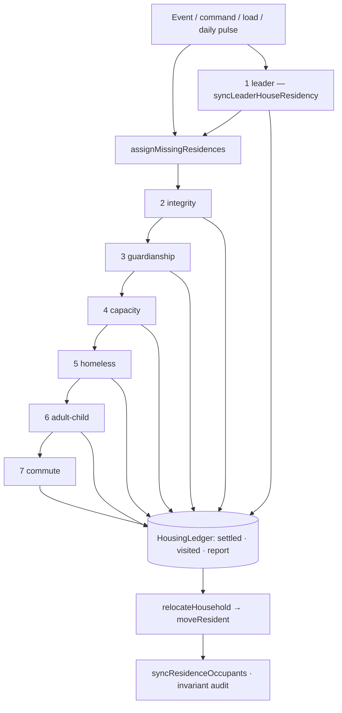

# Housing decision architecture — one authority, one order

Reference for how the colony decides **who sleeps where**. Owner module: `src/game/residencyReconciliation.ts`.
Companions: the mandate (`docs/plans/housing-architecture-2026-10-22.md`), the design argument
(`docs/plans/housing-and-relocation-design-2026-10-23.md`), and the per-section status
(`docs/HANDOVER-housing-architecture-2026-10-23.md`).

This document describes the code as it stands after the 2026-10-25 consolidation. If the two disagree, the
code is right and this file is a bug.

---

## 1. The shape that changed

Before, three engines moved households and none knew the others' intent: placement filled a home that fit,
the nest-leaving sweep moved an adult child into *any* empty home, and the commute trade then traded that
same household's home for a nearer one. Each rule was defensible alone; together they produced move events
that undid each other, and twelve call sites wrote `residenceBuildingId` directly, so no rule could be
reasoned about — or tested — inside the housing module.

Today there is exactly one of each thing that matters:

| Concern | Single owner |
| :--- | :--- |
| **When** housing is decided | `assignMissingResidences` — the only scheduler |
| **What was already decided this run** | `HousingLedger` — one per run |
| **How a decision is applied** | `relocateHousehold` for a household, `moveResident` for one settler |
| **Which home a settler should get (pure scoring)** | `residencySelection.ts` |
| **One residence write** | `moveResident` |

No phase function is exported as a scheduler. `tryMoveOutOfFamilyHome`,
`rebalanceAdultChildrenFromFamilyHomeWhenEmptyAvailable`, `rebalanceOvercrowdedResidences` and
`relocateHouseholdsForCommute` are exported only so tests and the benchmark can call them directly; inside
the simulation they run only from `assignMissingResidences`.



---

## 2. The phases, in order

`HOUSING_PHASE_ORDER` is the declaration; `assignMissingResidences` runs every phase in it except
`leader`, which `syncLeaderHouseResidency` runs just ahead of the sweep. A phase sees the previous phase's
result and nothing else's intent.

Class matters: **mandatory** phases fix something that is wrong. **Optional** phases only improve something
that is already acceptable, and they are the ones that can be withheld (§3).

| # | Phase | Class | The one question it answers |
| :-- | :--- | :--- | :--- |
| 1 | `leader` | mandatory | Does the leader's household hold the manor, and only them? |
| 2 | `integrity` | mandatory | Does every recorded home still exist as a player residence? |
| 3 | `guardianship` | mandatory | Does every minor without a parent have a custodian, and a bed with them? |
| 4 | `capacity` | mandatory | Is any home holding more settlers than it has beds? |
| 5 | `homeless` | mandatory | Does every settler the colony has a bed for have one? |
| 6 | `adult-child` | optional | Should an adult child still living at home take a genuinely empty home? |
| 7 | `commute` | optional | Would this whole household be meaningfully better off in a vacant home? |

### 1. Leader

The manor is a hold, not a placement: the leader's household occupies it and nobody else does.
`syncLeaderHouseResidency` is the phase's driver — it runs from the assignment layer just before the sweep,
and from an election, a succession or a Moon Howler reversion, which cannot wait for a pulse. Every move it
makes is a `relocateHousehold` decision with phase and reason `leader`: an eviction of a settler the office
no longer entitles, and a move-in of an entitled member without a bed there. Evicted settlers are then
seated by `assignMissingResidences` like anyone else.

The manor never counts its bed cap: it seats the whole entitled household, exactly as the capacity phase
never evicts from it. Every other check applies — a refused move leaves the settler where they are, and the
decision is logged in the run's report.

### 2. Integrity

A `residenceBuildingId` that points at a building that is gone, is not a residence, or belongs to a rival is
not an assignment. The phase clears it (reason `assignment`), and the settler becomes homeless for phase 4.
Nothing is placed here — repair and placement are different decisions.

### 3. Guardianship

Every minor without a living parent gets custody resolved once for the whole sibling set
(`ensureOrphanAdoption`: living relative, then grandparent of either gender, then a suitable couple, then a
single guardian), and the guardian's household is placed as one. A child is never seated alone before this
runs, and the Leader's House is never a guardianship destination.

### 4. Capacity

`rebalanceOvercrowdedResidences` relieves an over-full home **before** anyone new is seated, so a newcomer
can never be packed into a house that was already too full. The shortage order is fixed:

1. move unrelated residents out first;
2. if the home is still over its beds, move the whole family together;
3. if no home fits the family, keep the dependent group (custodian + minors) together and unhoused rather
   than overfill the house or split the children from their guardian.

Destinations come from `evictionTargets`: completed player homes only — never the manor, never a rival
camp, never an unfinished site. A settler is unhoused rather than sent somewhere they cannot legally live.

### 5. Homeless

Seat every household the colony has beds for. Units are built and sorted once, family-first and
custodian-following, and the loop is bounded (24 passes with early exit when nothing moved). Two shapes:

* **Immediate convergence** (no `sweepTick`): a load, a player command, an arrival or any event must not
  wait for a bucket. The whole colony converges on this call.
* **Bucketed sweep** (`sweepTick` given): only the pulse's quarter of *already-housed* units is swept
  (`RESIDENCE_SWEEP_BUCKETS = 4`), in up to three passes; the final pulse of the day revisits everything
  once so a home released late in the day is not wasted until tomorrow.

The capacity rebalance and the post-eviction homeless refill stay **global** on every call, whatever the
bucket: a settler who loses a bed is never left outside until the cycle comes round.

### 6. Adult child

An option, not a duty. Candidates are adult children living in a family home (never the manor), eldest
first, and a move needs an empty home that fits the **whole departing household**. The Leader's House is
never a destination here: the move is refused rather than reported and left standing. If the household a
mandatory phase settled, this phase is skipped for them — that is the protection rule in §3.

### 7. Commute

The only relocation engine: a daily, batched, route-aware trade, run only on the last sweep bucket of the
day. A move must clear `RELOCATION_MIN_SAVED_HOURS` (0.5 h/day) and beat the current home by
`RELOCATION_MIN_IMPROVEMENT_RATIO` (25 %); **no individual member's own daily travel may worsen** by more
than `RELOCATION_MAX_MEMBER_REGRESSION_HOURS` (0.25 h/day), and every pupil must keep school reach. At most
`MAX_RELOCATIONS_PER_DAY` (8) households move per colony per day. Both the vacant list and the household's
previous home are updated after every move, so the next household prices the colony as it now is.

### Closing steps

After the six sweep phases: one final `fillHomelessAfterEviction`, one `syncResidenceOccupants` (the roster is
derived from the links once, at the end — never maintained by hand mid-pass), then the invariant audit.

---

## 3. The ledger — how a run remembers itself

Every run allocates its own `HousingLedger`, so no state leaks between pulses:

| Field | Meaning |
| :--- | :--- |
| `settled` | settler id → the phase that decided their home. The protection key. |
| `visited` | settler id → homes that settler's household already held this run. |
| `before` | residence per settler when the running phase began, so the phase can log its moves. |
| `reported` | settler id → the home a recorded household move already logged in this phase. |
| `report` | `relocations[]`, `protectedUnits`, `violations[]` — returned to the caller. |

**Protection.** `isHousingUnitProtected(ledger, unit, phase)` is consulted by every optional move. If any
member of the household was settled by a mandatory phase in this run, the optional phase leaves the whole
household alone and counts it once in `protectedUnits`. A mandatory phase is never protected: a correction
always outranks an earlier decision.

**No re-entry.** `relocateHousehold` refuses a destination the household has already lived in during this
run. Together with protection this makes the pipeline idempotent: running it twice on the same state
produces zero relocations the second time, which is exactly what `tests/housingAuthority.pipeline.test.ts`
asserts.

**Reporting.** `relocations` carries the phase, a `reason`, the members, and `from`/`to`. A move applied by
`relocateHousehold` records its real reason; a move a phase made through a nested helper is logged by
`endHousingPhase` grouped per `from → to`, with reason `commute` for the commute phase and `assignment`
otherwise. The report is diagnostic data — no phase reads it to decide anything.

---

## 4. Whole-household decisions

`relocateHousehold(unit, toId, phase, reason, context)` is the only place a multi-settler housing decision
becomes writes. Before a single member moves it verifies:

* the household is not protected from this phase (§3);
* the destination exists, is a player residence, is completed, and is not a rival's;
* the household has not already lived there this run;
* the destination is not the Leader's House, unless the reason is `leader`, `birth` or `moon-form`;
* `familyFitsInResidence` — the whole household fits in the destination's remaining beds (a `leader` move
  into the manor skips this, as the capacity phase already never evicts from it);
* `custodianTravelsAlong` — no minor in the household would land where their living custodian is not.

If any check fails, **nobody** moves. Only then does each member go through `moveResident`. If the writer
refuses every member (a stale guard, a leader-house rule), the decision is rolled out of the report rather
than reported as done: a refused write is not a decision.

`moveResident` stays the single residence write. It keeps the occupancy index, the household traits and the
building's `occupants` roster consistent, carries the reason, and refuses ordinary moves out of or into the
Leader's House.

### Who calls it

Every relocation inside the pipeline that moves more than one settler goes through `relocateHousehold`:
homeless placement and its split fallbacks (`assignFamilyToResidence`), capacity rehousing and the surplus it
unhouses (`rebalanceOvercrowdedResidences`), a sibling set with no guardian (`ensureOrphanAdoption`), a couple
forming a household (`syncPartnerResidence`), the adult-child move and the commute trade. No phase loops over
members and calls `moveResident` for each — a household either passes the checks above or stays put.

`moveResident` is left for decisions that are genuinely about one settler: the integrity clear, a birth, a
death, a departure, a demolition, a prison or Moon Howler transition, one adult moving out of a guardian's
home, and a child following an already-placed custodian (death cleanup, divorce). The manor hold
(`leaderHouse.ts`) decides one entitled member per call, and each of those calls is a `relocateHousehold`
decision too.

---

## 5. The invariant audit

`collectHousingInvariantViolations` runs on the pipeline's **own output** and fills `report.violations`
with what the boundary promised and did not deliver:

* a settler referencing a home that is not in the residence set;
* a non-manor home holding more settlers than its beds;
* a minor living apart from their custodian, when both have a home.

The audit reports; it never silently repairs. Callers and tests read `violations`, so a broken invariant
surfaces as a named failure with the settler or home id in it, not as a household that quietly moved.

---

## 6. When the pipeline runs

| Trigger | Call | Behaviour |
| :--- | :--- | :--- |
| Assignment pulse (`LAYER_ASSIGN_INTERVAL`, four per day) | `tickLayerAssign.ts` with `world.tick` | one sweep bucket; commute only on the last pulse |
| Save load | `saveLoad.ts`, no tick | full convergence |
| Player command (assign, evict) | `buildingResidencyActions.ts` / `settlerInteractionActions.ts` | full convergence |
| Building placed, upgraded, demolished | `buildingPlacementActions.ts` / `buildingMaintenanceActions.ts` | full convergence |
| Births, arrivals | `dailyPopulation.ts` (with tick) | newcomers are homeless, so the global fill seats them now |
| Divorce, marriage, leadership, arrest, release, moon-form | their owner modules | full convergence after the event's own write |
| Leader elected, dies, or reverts from Moon Howler form | `leaderHouse.syncLeaderHouseResidency` | the `leader` phase moves the entitled household, then the sweep seats the evicted |

The pulse short-circuits when the housing signature (residences plus each settler's home, partner, parents,
age class and prison) is unchanged since the last sweep, so a quiet colony costs nothing.

`RESIDENCE_SWEEP_BUCKETS` must equal the assignment layer's pulses per day (4). The guard test pins that
coupling; changing one without the other means some households are never revisited.

---

## 7. Events invalidate; the pulse decides

An event owns the link it is about — a divorce ends a shared home, a death clears a reference, an arrest
sets `prisonBuildingId` — and it applies that through `moveResident` with its own reason (`divorce`,
`death`, `prison`, `player`, …). It does **not** choose a settler's next home. That is the pipeline's
decision, and the event asks for it immediately afterwards.

This is the boundary that lets housing be reasoned about in one module: rules that live in a caller cannot
be tested with the rest of housing, and a caller that picks a home is a second scheduler by another name.

---

## 8. Prisoners — a bed and a post, not a housing event

A sentence is not a housing decision. `prisonBuildingId` is set; `residenceBuildingId` and
`workerBuildingId` are left exactly as they were.

* The prisoner keeps their bed, and `isImprisoned` keeps them out of the movable set (`alive`), so nobody is
  seated in a bed that is still theirs.
* The prisoner still counts for capacity — the bed is reserved, not free.
* The post is held: the colony does not refill a job that still has an owner, and the prisoner produces
  nothing while jailed.
* A prisoner is not on a construction crew, so a building site never counts them as a builder.
* Release is uneventful: the settler walks home to the house that never changed.

---

## 9. What this pipeline does not own

* **Staffing and job posts** — `workforce.ts` (`clearWorkerAssignment`, `detachWorkplaceReference`).
* **Leader entitlement** (who the manor admits) — `leaderHouse.ts`, which applies it through the `leader`
  phase of this pipeline rather than writing residence ids itself.
* **Pure scoring** (which home fits, which trade is worth it) — `residencySelection.ts`.
* **Derived rosters for views** — `syncResidenceOccupants`, called once at the end of a run.
* **Family structure** — `householdComposition.ts` / `genealogyTypes.ts`.

A rule belongs in exactly one of these. If a housing rule appears in a caller, it is in the wrong place.

---

## 10. Adding or changing a rule

1. **Choose the phase.** A correction of a wrong state is a mandatory phase; an improvement is optional.
   Adding a phase means adding it to `HOUSING_PHASE_ORDER` and deciding its class in `MANDATORY_PHASES`.
2. **Keep selection pure.** Scoring lives in `residencySelection.ts` and returns a decision, never applies it.
3. **Apply through `relocateHousehold`.** Never write `residenceBuildingId` outside `moveResident`; never
   move part of a household through it.
4. **Take the ledger.** Every optional move asks `isHousingUnitProtected` first; every phase is wrapped so
   its moves land in the report.
5. **Do not export a scheduler.** Phase functions stay reachable only from `assignMissingResidences`.
6. **Register the function** in `OWNERSHIP_OVERVIEW.md` (one owner, always) and pin the boundary in
   `tests/housingAuthority.pipeline.test.ts` — protection, whole-household refusal, or idempotency.

---

## 11. How to verify

```sh
npx vitest run tests/housingAuthority.pipeline.test.ts tests/residenceCommuteRelocation.test.ts \
  tests/relocation.fairnessAndQuota.test.ts tests/prisonStay.holdsHomeAndPost.test.ts \
  tests/residencyCapacity.excludedResidents.test.ts tests/housingArchitecture.completion.test.ts
```

| Promise | Pinned by |
| :--- | :--- |
| One order, optional phases withheld after a mandatory decision | `housingAuthority.pipeline.test.ts` |
| A second run repeats nothing | `housingAuthority.pipeline.test.ts` |
| Whole household moves or none of it | `housingAuthority.pipeline.test.ts` |
| Eviction targets are real, completed player homes | `residencyCapacity.writers.test.ts`, `housingArchitecture.completion.test.ts` |
| Capacity counts residents the pass may not move | `residencyCapacity.excludedResidents.test.ts` |
| Commute fairness, thresholds and the daily cap | `relocation.fairnessAndQuota.test.ts`, `residenceCommuteRelocation.test.ts` |
| A sentence keeps home, post and family in place | `prisonStay.holdsHomeAndPost.test.ts` |
| A day's work spreads over the four pulses | `residency.dayBoundary.budget.test.ts` |
| Long-run stability (churn, not just consistency) | `scripts/run-full-year.mts` housing counters, `tests/fullYear.integration.test.ts` |

---

## 12. Still open, and owned by the owner

* **Adult children at 18.** The pipeline treats the move as an option that needs a genuinely empty home that
  fits the whole household; whether a settled family's 18-year-old should move at all is still the owner's
  decision.
* **The Day 121 churn report** cannot be reproduced from this repository: only the Day 69 save is present.
  The churn guard is a guard, not a reproduction.
