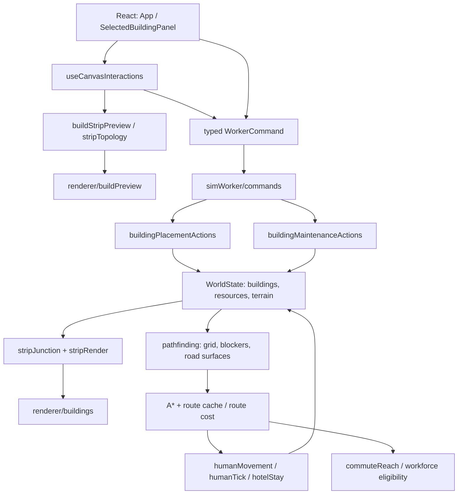

# Roads, walls, gates and navigation — implementation architecture

**Wilderfolk 0.6.5.2 / PR #59 / Issue #49**  
**Status:** implementation merged into `main` and accepted as PR #59 on 27 October 2026; follow-up fixes #65/#66 are also merged. Verification scope limitations below remain historical, not an open PR status.  
**Source of truth:** code on the branch, `AGENTS.md`, `OWNERSHIP_OVERVIEW.md`, and [issue #49](https://github.com/Rengerams/wilderfolk/issues/49). This document describes the architecture *as implemented*, including limits, rather than proposing a second infrastructure system.

## 1. Purpose and invariants

One command should build or remove a bounded chain of infrastructure. Preview and commit must use the same placement rules; terrain, construction resources, and existing structures are validated in the authoritative placement owner.

* Completed roads and bridges are traversable; a movement speed bonus is applied **only while the walker is on the completed surface**.
* Completed walls and explicitly **closed** gates block walking. An open completed gate is a real crossing, not merely a decorative sprite.
* An unreachable target cannot cause a straight-line fallback through a wall, river, or diagonal blocked corner.
* A failed wall-to-gate replacement must preserve the original wall.
* Every resource debit, capped refund, building deletion, assignment reconciliation, and saved-state change occurs in its existing world-state owner; previews are read-only.
* The same saved footprints inform intersections, visual forms, physical collision, and route cost. Neither sprites nor proximity alone establish connectivity.
* Avoid additional per-tick global A* passes or a second parallel road/pathfinding engine.

## 2. Runtime topology

No diagram arrow grants writing authority: rendering and React consume read-only projections, and commands perform the mutations in the simulation state.

### Ownership map

| Concern | Canonical implementation | Key functions/data |
| --- | --- | --- |
| Strip gesture and UI dispatch | `src/hooks/useCanvasInteractions.ts`; `src/App.tsx` | pointer stroke, rectangle demolition, `stripChainCommand` and typed command dispatch |
| Segment constraints and rotation | `src/game/stripBuild.ts` | `isStripBuildType`, `inferStripRotation`, `computeStripSegmentCenters`, `MAX_STRIP_SEGMENTS` |
| Road/wall planning and snapping | `src/game/stripTopology.ts` | `buildStripPlanFromDrag`, `buildStripPlanFromStroke`, `resolveRoadStripPlan`, `resolveWallStripPlan`, `collectRoadEntranceSnapPoints`, `collectStripDemolitionIds` |
| Junction classification | `src/game/stripJunction.ts` | `analyzeStripJunction`, `connectionsAt`, `classifyJunction`, `detectBuildingJunction` |
| Placement verdict and build | `src/game/placementUtils.ts` and `src/game/buildingPlacementActions.ts` | `stripCrossingIsTheOnlyOverlap`, `getPlaceBuildingFailureReason`, `buildStripPreview`, `placeStripChain` |
| Demolition, refunds, gate control | `src/game/buildingMaintenanceActions.ts` | `demolishStripBuildingsInPlace`, `refundBuildingCost`, `removeBuildingFromState`, `toggleWallGate` |
| Command protocol | `src/game/simWorker/commands.ts` | `isWorkerCommand`, `applyWorkerCommand` and validated operation payloads |
| Rendering | `src/game/stripRender.ts`, `src/game/renderer/buildings.ts`, `src/game/renderer/buildPreview.ts` | painter, junction overlay, gate latch and affordability preview |
| Art loading | `src/game/spriteLoader.ts` and `public/sprites/` | existing authored tiles, registered CC0 art and procedural fallback |
| Routing and passability | `src/game/pathfinding.ts` | `buildPathGrid`, `walkRoute`, `steerWithPath`, `isWalkStepAllowed`, `isOnWalkableRoadAt` |
| Entity movement | `src/game/simulation/humanMovement.ts`, `src/game/humanTick.ts`, `src/game/hotelStay.ts` | collision-aware walking and exact surface bonus (including hotel visitors) |
| Work commute reach | `src/game/commuteReach.ts` | `routeCommuteHours`, `straightRouteCost`, bounded search budgets |
| Saved infrastructure | `src/game/buildings.ts` and existing save/worker transport | building IDs, completion, rotation, optional `gateClosed` |

The exhaustive function-to-module inventory lives in `OWNERSHIP_OVERVIEW.md`. This document explains responsibilities and interfaces without creating a second ownership registry.

## 3. Construction from pointer to world state

1. The selected tool receives a gesture through `useCanvasInteractions`. Straight drag, orthogonal L-drag, genuine freehand bends, and Alt-drag demolition use bounded plans.
2. `stripTopology` projects stroke steps onto orthogonal segments, filters minor pointer jitter, samples existing finished strip footprints for snapping, and optionally snaps road endpoints to suitable **building front approaches**. Existing infrastructure snap points take precedence.
3. `stripBuild` provides finite segment counts, footprint centers and rotation. Saved segment rectangles, not a loose drawing-only radius, decide final junctions.
4. `buildStripPreview` asks the existing placement validator for each candidate segment and simulates a sequential wood/stone/gold budget on **detached** objects. Replacement refunds are capped using the same refund owner but preview calls must not mutate authoritative inventory or lifetime gathering statistics.
5. The renderer displays accepted/refused segments, connection shapes, material totals and shortages. An incomplete wall run must not be depicted as sealing an enclosure.
6. Release sends one validated command. `placeStripChain` rechecks live state (the preview can be stale) and deducts real resources only for successfully placed pieces. Invalid pieces are refused with feedback; no visual preview grants permission to bypass validation.

The geometry and placement owners preserve duplicate detection and allow legitimate perpendicular intersections while respecting the distinct semantics of roads versus solid walls. Roads may be placed on dry, ordinarily walkable terrain, including rocky terrain, but do not grant bridge rights across water or reserved obstacles.

## 4. Wall segments and gate state

Wall sections and wall gates remain building records with stable IDs and orientation. Gate placement can replace one aligned wall section; placement is first checked against a temporary state with the candidate wall omitted. Only a valid placement executes removal, capped refund and new construction. Adjacent walls are preserved.

`toggleWallGate` changes only a completed eligible gate through a validated worker command. An absent `gateClosed` field on a legacy gate means **open**; a true value means **closed**. The path grid treats a closed gate as a solid wall blocker and refreshes when the saved gate state changes. `renderer/buildings.ts` adds a visible latch on closed gates. Renderer appearance cannot override simulation passability.

Wall collision applies across ordinary travel, diagonal steps, path smoothing and emergency repositioning. A failed route stops or follows existing unreachable-target handling; it never grants permission for a direct pass through a blocked footprint.

## 5. Roads, route costs and actual movement

`pathfinding.ts` retains the existing A* search and route cache. Its raster combines terrain, blocking structures, road/bridge cells and **exact surface rectangles**. The route planner's discounted movement cost must agree with the speed applied by the movement owner: off-surface points do not receive `ROAD_SPEED_MULT` even when inside a broadly road-marked grid cell.

A straight unobstructed route is a candidate, not an unconditional winner. The bounded planner may pick a longer paved detour if expected **travel time** is lower. Accepted waypoints must survive the final approach, and steering handles high-speed overshoot; rejected detours remain cached rather than retriggering A* at each crossed tile. Completion, deletion, closure or geometry changes invalidate affected routing state.

`humanMovement.ts` and `humanTick.ts` apply step collision and real on-road speed. The hotel visitor steering path uses the same actual speed treatment as the detour cost used to select roads. `commuteReach.ts` prices work reach from the current path grid where available; when a grid cannot be used, `straightRouteCost` weights only the exact *covered portions* of a straight line instead of granting whole-trip benefits after crossing one small road.

Roads and bridges differ materially: legacy saved roads over water do not silently clear a water blocker, while completed valid bridges may allow crossing under bridge-specific rules.

## 6. Demolition, integrity and caching

Alt-drag over the matching selected strip family collects a bounded, player-owned list of building IDs. The worker validates the batch and performs removal through `demolishStripBuildingsInPlace` / the existing batched removal owner. Ordinary buildings must remain untouched by strip selection. Removal uses authoritative resource refunds and assignment bookkeeping; the world need not be cloned once **per segment**.

Construction completion, wall/gate state, road geometry, demolition and legacy hydration must all be reflected in path-grid signatures/cache refreshes. Rendering can reuse collected topology within a render family rather than rescanning the whole world for every wall sprite.

The virtual player calls the same construction owners, preserves the food reserve before discretionary paving and deducts shared resource budgets across multi-leg road projects.

## 7. Saves, compatibility and transport

Existing saves continue to load their road, bridge, wall and gate building records; ID, footprint, rotation, construction progress and resource fields remain meaningful. `gateClosed?: boolean` is an **optional** extension, so old saves create open gates rather than requiring a migration to a new infrastructure graph. Worker state changes must travel through the existing save/delta pipeline. Synthetic legacy 0.6.5.0 infrastructure fixtures exercise repeated loading and compatibility.

A real historical-save replay and a 1,800-settler responsiveness benchmark were expressly removed from this PR's *mandatory* acceptance scope by the issue owner. That does **not** remove the ordinary save, invariant and performance gates.

## 8. Validation and failure boundaries

Relevant automated checks include `tests/infrastructure.acceptance.test.ts`, `tests/stripTopology.connections.test.ts`, `tests/stripJunction.geometry.test.ts`, `tests/stripPlacement.crossings.test.ts`, `tests/stripDemolition.workerProtocol.test.ts`, `tests/pathfinding.test.ts`, `tests/medium-A-movement.test.ts`, `tests/wallGate.rendering.test.ts`, `tests/workCommute.leadHour.test.ts` and the annual simulation integration. Existing browser infrastructure visual inspections cover multiple zoom levels.

Validate on the final commit with `npm run test:types`, `npm run lint`, `npm run build`, the required automated test gate and GitHub Actions' performance comparisons. A green run is evidence for *that commit only*. UI responsiveness for every map size and all real historical saves remain unproven beyond the explicitly run scenarios.

### Maintenance rules

* Change the owning module, then update `OWNERSHIP_OVERVIEW.md` when a named helper is introduced, renamed, moved or removed.
* Prefer direct imports from the implementation owner. Avoid unnecessary import renaming, mirrored constants, forwarding functions and re-export barrels.
* Keep named nontrivial thresholds in the owning module; do not create drawing-only approximations of collision, affordability or speed rules.
* Add focused regression tests for each new contract risk and record meaningful gameplay or workflow changes in `CHANGELOG.md`.

## 9. Alias and ownership audit — 27 October 2026

### Forwarding and compatibility

- Removed the duplicated local `buildingStripRotation` adapters in `stripTopology.ts` and `stripJunction.ts`. Both call the pre-existing authoritative `normalizeBuildingRotation` helper directly. This avoids two locally owned names implementing the same one-line transformation.
- Removed the unnecessary `isFootprintOnBuildableTerrain` re-export from `buildingPlacementActions.ts`; `buildingActions.ts`, a documented legacy public façade, now resolves it **directly** from its actual owner `placementUtils.ts`.
- Retained the deliberate `buildingActions.ts` / `gameEngine.ts` legacy API boundaries, because deleting those exports would break established consumers without improving the underlying ownership. The pre-existing geometry re-exports from `placementUtils.ts` similarly remain as compatibility paths for existing callers, but **do not** contain alternative implementations.
- `walkRoute`, `stripChainCommand` and the strip-demolition selection path were not classified as aliases: they each add a distinct retry policy, validated command construction or domain validation on top of another owner, rather than merely renaming a function.

### Function registration

The `OWNERSHIP_OVERVIEW.md` **PR #59 function-level ownership supplement** records named declarations and named arrow helpers missing from the existing index in PR-touched production, UI and tooling modules. It does not reassign functions previously owned elsewhere. Inline anonymous callbacks remain implementation details of the containing function. This targeted inventory is **not** a whole-repository proof of every historical helper in unrelated modules.

### Read-only preview accounting

`buildStripPreview` estimates wall replacement refunds using a temporary budget with its **own** `resources` and `lifetimeStats.totalResourcesGathered` objects. The refund owner calls `addResource`, which normally records accepted additions as resources gathered. Sharing that nested lifetime-statistics object with the real `WorldState` previously inflated gathered totals on repeated cursor previews, even after cancel. The isolated copy prevents this side effect; the worker's authoritative placement/refund behavior is unchanged. A regression test invokes the same valid gate preview twice and checks original resource balances and lifetime statistics stay unchanged.

**Verification rule:** findings above describe reviewed code changes, not a passing final CI run. Check the latest PR head's GitHub Actions and typecheck/lint/build before merging.
