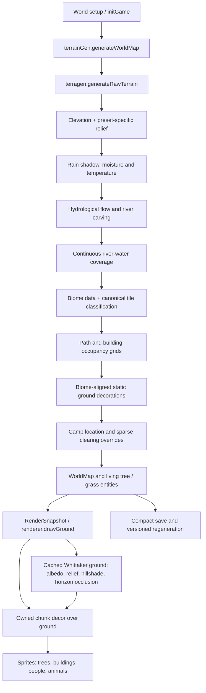

# Wilderfolk terrain architecture

**Scope and acceptance:** terrain-preset implementation PR #63 merged into `main` and was accepted on 27 October 2026. A subsequent version-3 naturalism upgrade is proposed separately and awaits CI and visual playtesting; do not mistake this document for an acceptance statement.

**Authority:** `AGENTS.md` governs changes; `OWNERSHIP_OVERVIEW.md` registers each function with one owning module. `src/game/terrain/terrainGrid.ts` owns the tile projection, `src/game/terrain/terragen.ts` owns generation, and the renderer owns presentation. Do not introduce another terrain classifier, save generator or convenience re-export.

## 1. Runtime flow

The simulation keeps a **top-down world-coordinate system**. The so-called 2.5D appearance is obtained from a height field, directional shading, cast shadows, horizon occlusion and contact shadows; it is **not a 3D mesh**. Pathfinding, building placement and entity locations do not change when lighting changes.

## 2. Coordinate systems and authoritative data

| Layer | Owner | Resolution / role | Source of truth |
|---|---|---|---|
| World pixels | `worldGen.ts`, `viewState.ts` | entity positions, camera, placement | `WorldState.width/height` |
| L2 climate/height | `terrain/terragen.ts` | `TERRAIN_CELL = 16` world pixels | `WorldMap.elevation/moisture/temperature` |
| Fine water coverage | `terrain/terragen.ts` | `WATER_CELL = 16` world pixels, independent lattice | `WorldMap.riverDist` |
| L0 occupancy | `terrain/terrainGrid.ts` | `PATH_CELL = 10` pixels | `WorldMap.pathGrid`; never infer walkability from colour |
| L1 building occupancy | `terrain/terrainGrid.ts` | `BUILD_CELL = 20` pixels | `WorldMap.buildGrid` |
| Sparse player edits | `terrain/terrainGrid.ts` | tile index → `TerrainTile` | `WorldMap.overrides`, read by `tileAt` |
| L3 scenery | `terrain/terragen.ts` + `renderer/decor.ts` | points in world pixels, baked by chunk | `WorldMap.decorations` |
| Living flora | `worldGen.ts` and `blueberryForaging.ts` | dynamic entities | `WorldState.entities`; painted by `renderer/trees.ts` and `renderer/grass.ts` |

`classifyTile` in `terrain/terrainGrid.ts` is the canonical terrain-type decision. It combines elevation, moisture, temperature, water coverage and the generator's recorded forest thresholds. Use `tileAt` / `tileTypeAt` for gameplay decisions: they also apply sparse overrides. The 15-label coarse `WorldMap.terrain` biome array is descriptive generation data, **not** another source for a building's terrain type.

## 3. Generation and preset identity

`terrainGen.generateWorldMap` chooses or derives dimensions, calls `generateRawTerrain`, selects a usable camp site and applies local overrides. It supports both the map-size overload and the existing world-pixel-size overload. `initGame` in `worldGen.ts` owns settler, tree, grass and wildlife creation; the raw terrain generator does not spawn those entities.

`terragen.generateRawTerrain` constructs the height field from seeded noise, then applies version-2 preset-specific relief before moisture, temperature, river routing and classification. The intended landscape differences are:

| Preset | Distinguishing features |
|---|---|
| Arabia | dry open terrain with dispersed springs and wet fringes |
| Oasis | dry outer area surrounding a central water source and greener zone |
| Black Forest | dense, continuous wooded ground beyond a small camp clearing |
| Coastal | a distinct ocean-facing margin, beach and inland region |
| Islands | separated landmasses and channels rather than one uniform continent |
| Highland | ridges and elevated rocky areas |
| Scandinavia | colder relief with sea-level fjord inlets |
| Rivers | a denser drainage selection and wider river network |
| Meadows | flatter, lower-relief pasture |
| Continental | a mixed reference landscape |

The configured start resources remain unchanged across presets. More realistic starts should come from terrain, not from silently replacing the player's supplies.

### Hydrology

`terrain/hydrology.ts` owns depression filling, downhill drainage and accumulated catchment. `carveRivers` selects headwaters and follows that network into joined channels; channel width follows catchment, not arbitrary per-frame decoration. Version 2 rasterizes linear water segments with interpolated widths. Version 3 interpolates the segment centreline with a half-step Catmull–Rom curve before rasterizing its water coverage; the underlying drainage graph and stored polylines are unchanged. Version 1 keeps point stamping. `classifyTile` and the shader both use the resulting water coverage.

River water is painted in the **continuous ground shader**. In version 3 the shader reserves blue water primarily for the gameplay channel (`riverDist > 0.55`) and paints the adjoining riparian ground as wet soil. Version 3 also propagates a bounded moisture gradient away from river cells, permitting riparian biome transitions. The static decor pass does not add a second vector river stroke. Water masks, water-tile classification and colour should be tested together: a pretty blue ribbon is not sufficient if pathfinding still considers it dry land.

### Biome and object selection

`decorBiomeForTile` chooses allowed ground props from the canonical tile type at the prop position, while the coarse biome may supply meadow detail. New-generation forest floor density is intentionally reduced so tiny vector bushes, mushrooms and rocks do not visually compete with the full-height, harvestable tree sprites. Water and river tiles receive no terrestrial decor props. New-world ambient tree clusters, ordinary grass and blueberry trees are also restricted to suitable terrain. Tree sprites are entities, not a second static forest layer. Version-3 worlds place harvestable trees on staggered and jittered sites, with noise-modulated groves and glades, low-density riparian trees, and weighted sprite variants. Existing versions keep their original spawn sequences.

## 4. Renderer and 2.5D lighting

The render entry point is `renderer.ts`. `renderer/terrain.ts` budgets and caches viewport ground chunks; `renderer/whittakerTerrain.ts` paints the terrain's **actual continuous fields** rather than stretching a single sprite per biome. Its reusable `buildWhittakerFields` precomputes smoothed height, slopes, neighbourhood relief, terrain shadows, proximity to water and a horizon-based ambient-occlusion term. `bakeWhittakerGround` then combines climate-dependent albedo, sand/rock/snow/grass detail, water-depth colours and those lighting fields into RGB pixels.

The horizon occlusion runs **once per map field cache**, with bounded neighbouring height samples, not as a per-pixel ray trace. Likewise, terrain pixel bakes are spread across frames with preview steps and a fixed budget. This maintains the existing Canvas2D renderer, avoids WebGL and preserves responsiveness at larger world sizes. Rendering does not modify the simulation elevation, waterline or navigation surface.

Chunked decor is rendered in `renderer/decor.ts` and composed **after all ground chunks**. The margin gives large objects room to overhang a chunk edge; a separate owner rectangle ensures each prop's anchor belongs to **exactly one chunk**, preventing duplicate plants and disappearing props at seams. Cached decor does not use a per-object CSS filter. `renderer/trees.ts` renders living trees separately with sprite depth ordering, ground contact and shadows.

`renderer/terrain.ts` builds its terrain cache key from map seed, recorded terrain seed, generation revision, preset, world dimensions and terrain edit revision. Cache keys are not an alternative source of terrain data.

## 5. Interaction, economy and saves

- **Placement and terrain reads:** `buildingPlacementActions.ts` samples `building.siteTerrain` before construction clears forest into grass. `terrainSystems.getTerrainEfficiencyMultiplier` uses that original site type, so production yields do not silently change because placement altered the displayed tile.
- **Changes to ground:** camp clearings and construction update `WorldMap.overrides`. `rebakeTerrainGrids` maintains the occupancy grids; callers should never write grid bytes from presentation code.
- **Persistence:** `saveLoad.ts` saves a compact terrain seed, overrides and `_generationVersion`. Old compact saves lacking the revision regenerate using version **1**; new maps use version **2**. Changing version 1's RNG order, width law or relief would break existing saves. A saved map is not reconstructed by the renderer.

## 6. APIs, aliases and ownership rules

Functions live in their implementation module and are imported directly from it; the detailed registry is `OWNERSHIP_OVERVIEW.md`. Examples: `generateRawTerrain` belongs to `terrain/terragen.ts`; `classifyTile` and `tileAt` belong to `terrain/terrainGrid.ts`; `buildWhittakerFields` belongs to `renderer/whittakerTerrain.ts`; `bakeDecorInRect` belongs to `renderer/decor.ts`; `drawGround` and `targetGroundStep` belong to `renderer/terrain.ts`.

Redundant rename-only import aliases (`SeasonEnum`, `TerrainTypeEnum`, `w2s`), a duplicate cache-key variable, and an alias-only exported ground-bake budget were removed. The `createEntity` re-export in `worldGen.ts` is retained as an **existing compatibility surface** for scripts still importing it; new code should import `createEntity` directly from `entityFactory.ts`. The convenience world-map and settler-age forwarding exports were removed from `worldGen.ts`; the established `gameEngine.ts` facade is unchanged.

Do **not** mistake legitimate alternate representations for unnecessary aliases: the coarse biome ids, continuous fields, 10-pixel tile projection, 20-pixel construction grid, sparse overrides and saved generation revision answer different questions. They must agree at their boundaries, not be blindly merged.

## 7. Tests and known limitations

Relevant regression coverage includes `tests/terragen.riverGeneration.test.ts`, `tests/terrain.presetIdentity.test.ts`, `tests/terrain.visualCoherence.test.ts`, `tests/terrain.siteYield.test.ts`, `tests/terrain.saveGenerationVersion.test.ts`, `tests/decorProps.tint.test.ts`, `tests/groundLook.bands.test.ts`, `tests/groundChunk.bands.test.ts` and the older compact-save tests. Verify generation determinism across seeds and sizes, continuity of water, buildable founding land, decor ownership, pixel budgets, biome-accurate spawning, original-site yields and old-save round trips. This section lists contracts to check; it does **not** assert that CI or browser appearance has passed.

**Open visual limitations:**
1. A 2.5D height-field painting suggests cliffs and valleys but does not create raised, occluding 3D mesh geometry. Entity sprites still use top-down world positions and sprite/contact shadows.
2. Sparse terrain overrides are authoritative for gameplay, but the continuous colour shader primarily reads underlying climate/height fields. A cleared campsite or edited tile may need a separate blended surface treatment to match its new gameplay label perfectly; avoid changing hydrology simply to paint an override.
3. Static decor is baked from generation-time points. Building placement and later landscaping need explicit decor invalidation/removal if persistent ground props are found under new structures.
4. Per-preset weather and daily ambient temperature are outside this rendering/generator change.
5. Actual readability, chunk-seam quality and framerate require in-game visual checks on representative seeds, zoom levels and map sizes; the version-3 PR does not yet establish their results.
6. Real species-specific tree artwork, sprites for streams/rapids and truly eroded valley geometry require further art or simulation work beyond the version-3 improvements.

## 8. Extension checklist

When changing a landscape preset, adjust the **generation-versioned** relief/biome rules, then check `terrainGrid` classification and path/build grids; only then adjust prop selection and renderer styling. Keep rendering deterministic, cached and visually consistent with gameplay. Register each new or renamed function under **one** owner in `OWNERSHIP_OVERVIEW.md`, keep change notes concise in `CHANGELOG.md`, add a focused regression test where the behaviour has a concrete failure mode, and verify typecheck/lint/build and visual seeds.
