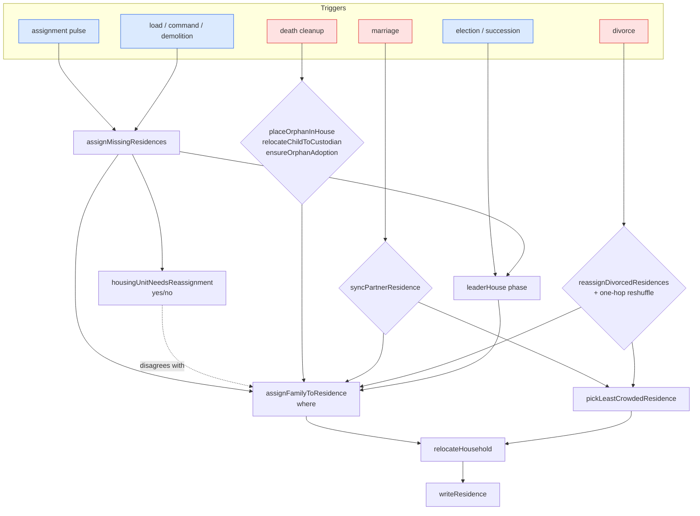
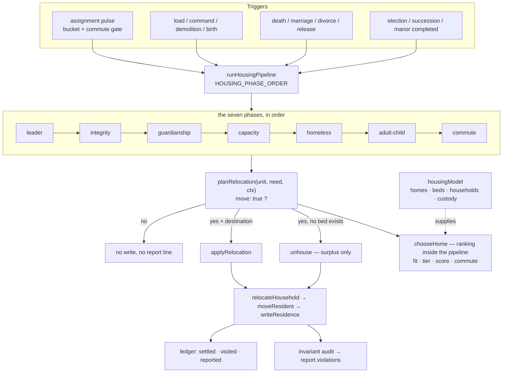
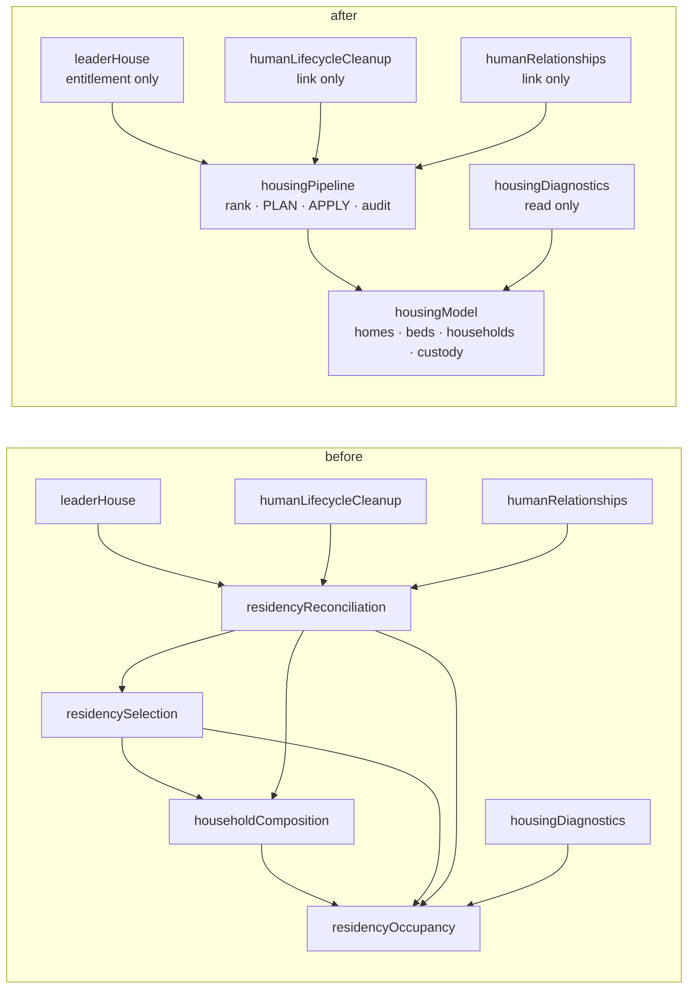
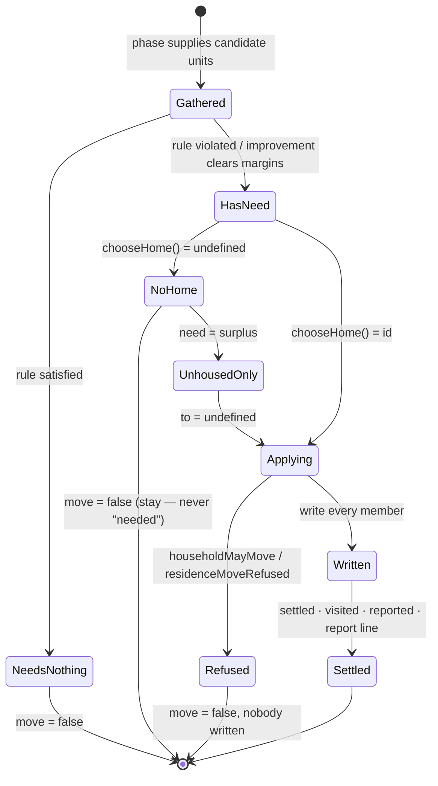
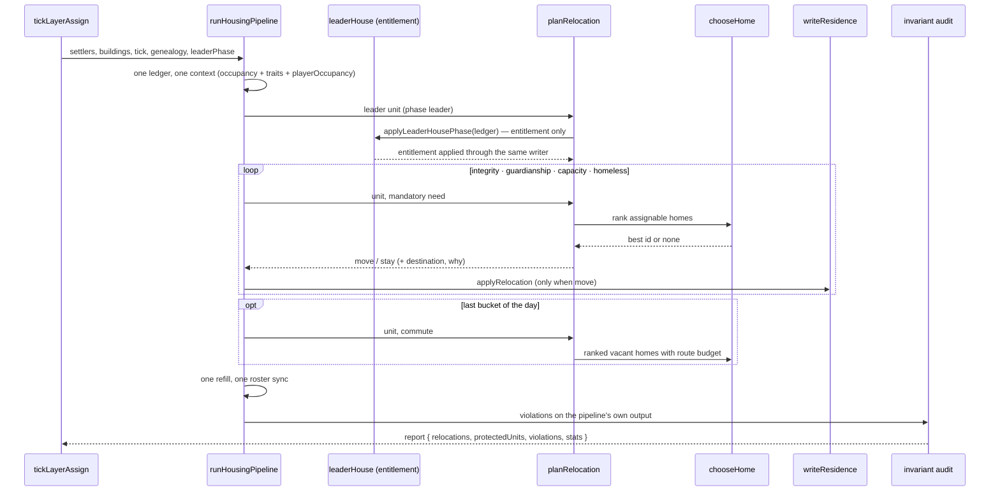
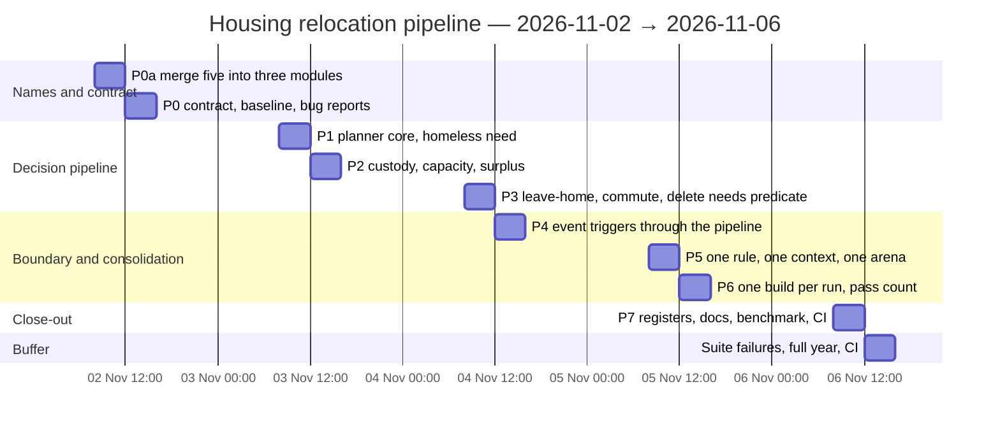

# Housing relocation pipeline — implementation plan — 2026-11-02

**Status:** P0a `d37efff9` and P1 `98c0f393` are committed. Four independent audits followed; their
findings are fixed in the working tree (repair-pass regression, exhaustive refusal retry, report
origin, shared building predicate, shortage semantics, stats and counter) and pinned by a 15-case
contract suite. Current tree: 35 files / 164 tests. P2 is next.
**Target version:** V.0.6.5.2.
**Owner module:** `src/game/housingPipeline.ts` (the pipeline). Supporting modules keep one job each
and lose every decision.

**Baselines.**

| Tree | Suites / tests | Recorded | Contains |
| :--- | :--- | :--- | :--- |
| `58ca1793` (pre-T0) | 33 files / 141 tests, 19.33 s | 08:51 | the original housing suite; the L2 counter was the *member comparison* from `ce853298` |
| `95ca783a` (T0 commit) | 34 files / 148 tests, 15.73 s | 09:36 | the invariant suite, the selection exclusion test, the retry fix, the write counter (`context.onMove`) |
| `d37efff9` (P0a commit) | 34 files / 149 tests, 32.12 s | 10:26 | `housingModel` + `housingPipeline` + `housingDiagnostics`; the four old modules are gone |
| **Working tree (P1)** | **35 files / 154 tests, 17.72 s** | **10:37** | plan/apply contract + five contract tests; the homeless phase plans through it; types, lint, build, duplicates, overlaps, cycles and source checks pass |

`95ca783a` also swept unrelated work from other agents in the tree (scripts, visitor/dialogue,
audio); it is the verified tree nonetheless. The L2 rule the plan builds on is the committed one:
progress is any residence write, not the member comparison.

**Audited 2026-11-02 08:48** by an independent read-only review; this version incorporates all 25
findings. One finding was overtaken by the tree twice: `ce853298` replaced attempt-counting with a
per-unit member comparison at 08:34, and T0 (`95ca783a`) replaced that with a real-write counter
(`context.onMove`). The plan adopts the committed counter (L2, G4) instead of rebuilding a third one.

---

## Mini-RFC

**Problem.** Five modules share the residence domain, and "does this household need to relocate?"
is answered in four different places: a boolean predicate (`housingUnitNeedsReassignment`), a
separate destination chooser (`assignFamilyToResidence` / `pickResidenceForHuman`), three event
wrappers (`syncPartnerResidence`, `reassignDivorcedResidences`, `placeOrphanInHouse`), and the
leader hold in another module. A "yes" from one is not a guarantee that the other can place the
household, and every caller supplies its own bed truth, so the same house can be full for one
trigger and empty for another.

**Minimal change.** Introduce exactly one decision contract — `planRelocation(unit, need, context)`
returning `{ move: false } | { move: true, to, reason, why }` — in the owning module. The seven
phases, the sweep and every event trigger ask it; delete every other "needs?" predicate, every
per-caller fallback chain and every ad-hoc destination search. Five modules become three, and the
three are named for what they do.

**Risk-impact.** Behaviour is preserved by a migration-only differential test until the old picker
is deleted (P3), then guarded by the housing suites plus a full simulated year. No bed rule, save
format, worker protocol or UI behaviour changes. Three deliberate corrections, all defects and not
policy: an adult-child move stops dragging independent adult descendants along (L1); the trait map
follows the same occupant rule as the beds, so a cursed Moon Howler is counted consistently (L3);
and `pairs` counts a couple once (L9).

---

## 1. The one question

> **For this household, right now: does a relocation happen — yes or no — and if yes, where to?**

Everything else in the five files is either a **fact** (who counts, how many beds, who belongs
together) or a **projection** (what the UI reads). Decisions belong in one place. Five files were
one too many: the target is **three modules**, each named for its single job, and only one of them
may answer the question. The merge is P0a — it lands before any logic so the migration never churns
a path twice.

| Module (after P0a) | Absorbs today | Name says | May it decide? |
| :--- | :--- | :--- | :--- |
| `housingModel.ts` | `residencyOccupancy.ts` + `householdComposition.ts` | homes, beds, occupants, households, custody — the domain's facts | no |
| `housingPipeline.ts` | `residencySelection.ts` + `residencyReconciliation.ts` | the one ordered process: rank, decide, apply, audit | **yes, only here** |
| `housingDiagnostics.ts` | unchanged (projection) | a read-only report | no |

`buildFamilyGroups` is not deleted: `src/game/PopulationPanel.tsx:5` imports it through the
`dayCycle` barrel and calls it at :118 for the Population tab. It is a grouping projection over the
family facts, so it moves to `housingModel` and the barrel keeps exporting it.

---

## 2. Why this is worth doing now (evidence from the 2026-11-02 review)

Line citations use today's paths; P0a merges and renames them (§4.10) before any logic changes.

| # | Finding | Evidence |
| :--- | :--- | :--- |
| L1 | An adult-child move drags independent adult descendants into the new home | `collectOwnHousehold` adds every living `childrenIds` entry with no age or residence filter (householdComposition.ts:21); the adult-child move uses it at residencyReconciliation.ts:1015 in `tryMoveOutOfFamilyHome` (defined :1006); `relocateHousehold` writes every member |
| L2 | ~~"Needs reassignment" counted attempts~~ — **half fixed by `ce853298`, completed by T0** | `ce853298` compares each unit member's residence before/after (:624–626, :655–657), which misses a real write to a custodian or guardian outside the unit. `95ca783a` (T0) counts every `writeResidence` through `context.onMove` (`moveCounter`) — the committed rule P0a/P1/G4 must adopt, not the member comparison |
| L3 | The threaded trait map drifts for a cursed Moon Howler | `buildResidenceTraits` filters `isPlayerHuman` (residencySelection.ts:590), `writeResidence` calls `residenceTraitMove` unfiltered (:289), `countResidentsInBuilding` counts `isResidenceOccupantEntity` — so beds and traits disagree for that settler on every pass |
| L4 | `coreCannotFit` is misnamed and its middle case is wrong | residencySelection.ts:289–290. Truth table: no guardian → true; guardian **has** a bed → true (short circuit); guardian has no bed → "no home fits the core". It is false only when a guardian exists, has no bed, and a home fits. The second operand is reachable — it runs exactly then. The defect is the inverted name/semantics, not dead code |
| L5 | `isHousingUnitProtected` mutates `protectedUnits` from a predicate | residencyReconciliation.ts:70 |
| L6 | The household rollback branch is unreachable | :192–197 vs the total `writeResidence` :271–297 — dead safety net, not a bug |
| L7 | The adult-child vacancy list only shrinks; a home vacated mid-phase is never added | :1035–1042 builds it, :1070 only removes the new home |
| L8 | Nested moves lose their real `reason` in the report | `endHousingPhase` :263 — documented behaviour, not a defect |
| L9 | `pairs` counts each couple twice (latent; every reader tests `> 0`) | residencySelection.ts:567–570; add and remove are symmetric |
| L10 | Pickers trust caller-filtered lists | `pickResidenceForFamily` filters only manor/rival; `pickLeastCrowdedResidence` does not filter rival at all |
| L11 | A refused destination ends the rehousing attempt, leaving a family outside | **fixed in the old code 2026-11-02** — capacity evicts from #100, the refill re-picks #100, `householdMayMove` refuses it as visited, no alternative was tried. `relocateFamily` now retries next-best (bounded); the generated suite's seed-2 cases and idempotency pass. Report `docs/bug_report/2026-11-02-housing-refill-proposes-visited-home.md` |

Measured duplication in these five files: **45 textual** leader-house/manor occurrences (41
`isLeaderHouseResidence` mentions including the definition and four import lines, plus 4 raw
`BuildingType.LeaderHouse` checks); 9 `isResidenceBuilding(`; 7 `completed`; **15 rival literals**
(6 `=== 'rival'` guards, 9 `!== 'rival'` filters) which are dead because camp structures are retired
on load and on the daily pulse (rivalEvents.ts:55–64, called :96 and saveLoad.ts:1672); the
manor-entry allowlist `['leader','birth','moon-form']` twice (residencyReconciliation.ts:140 and
:154); the residence-write context type declared twice (:274–279, :304–309); the divorce path
repeats the same eligible-home predicate four times (:1118, :1124, :1154, :1171) and runs two
near-identical filters differing only in `=== 0` / `> 0` (:1118–1123 vs :1124–1129), then
concatenates and re-sorts them.

---

## 3. Target architecture

### 3.1 Today — decisions leak out of the pipeline



Three deciders (the sweep, three event wrappers, the leader hold) and two placement brains
(`pickResidenceForFamily`, `pickLeastCrowdedResidence`) with caller-chosen precedence.

### 3.2 Target — one pipeline, one question



Every arrow into a write passes through one `planRelocation` answer. Nothing else may ask "does
this household need to move?".

### 3.3 Module graph — before and after



`housingDiagnostics` also reaches the pipeline indirectly today through the `dayCycle` barrel
(it imports the barrel for `TICKS_PER_DAY`), which is exactly why P0a step 5 forbids the barrel
from exporting the report.

`housingDiagnostics` also reads `populationGrowth` (`getOpenPlayerBeds`) and the clock; it never
imports the pipeline, which is what keeps the projection away from the writers.

### 3.4 The decision as a state machine



### 3.5 One pulse through the pipeline



---

## 4. The contract

### 4.1 Types (owner: `housingPipeline.ts`)

```ts
/** Why a household is being planned. A need is not a phase: triggers reuse needs. */
export type RelocationNeed =
  | 'homeless'    // a member has no bed and the colony can give one
  | 'custody'     // a minor is not with their living custodian
  | 'capacity'    // the unit's home holds more settlers than beds
  | 'surplus'     // no home exists for the whole unit: leave the overfull home
  | 'manor'       // the leader phase's entitlement decision
  | 'couple'      // partners form one household (marriage)
  | 'leave-home'  // an adult child takes a genuinely empty home (optional)
  | 'commute';    // optional, thresholded travel improvement

/** The one answer. `move: false` means stay put: no write, no report line, no retry. */
export interface RelocationPlan {
  readonly move: boolean;
  /** Only with `surplus`: there is no bed, the unit is unhoused. */
  readonly to?: number;
  readonly reason: ResidenceMoveReason;
  /** One label for the report/ledger: "over capacity", "custodian apart", "0.9 h/day saved". */
  readonly why: string;
}

export function planRelocation(
  unit: readonly Entity[],
  need: RelocationNeed,
  context: HousingMoveContext,
): RelocationPlan;

/** The only function that may turn a plan into a write. */
export function applyRelocation(
  unit: readonly Entity[],
  plan: RelocationPlan,
  phase: HousingPhase,
  context: HousingMoveContext,
): HousingRelocation | undefined;
```

`HousingMoveContext` is the single context type. P5 removes the duplicate inline literal used by
`writeResidence`/`moveResident` rather than introducing a second name.

### 4.2 Guarantees the contract must hold (each becomes a test)

| ID | Guarantee | Today |
| :--- | :--- | :--- |
| G1 | `move: true` ⇒ the destination exists, is assignable, is not the manor under an ordinary reason, and fits the whole household — checked *inside* the planner, not at write time | fails with a raw building list; also the open L11 report |
| G2 | `move: true` and `to: undefined` is legal only for `surplus` | not expressible today |
| G3 | `chooseHome` never returns a home `relocateHousehold` would refuse — a refusal must never be treated as "no destination" | two independent rule sets; L11 |
| G4 | A household with no reachable placement plans `move: false` (stay) and the pass ends; **progress is any residence write** (`context.onMove`), including a custodian or guardian moved outside the unit | the old member comparison is narrower; the committed write counter is the rule to keep |
| G5 | One occupant rule: beds, traits and rosters agree, cursed Moon Howlers included | three answers |
| G6 | A plan carries its own `why`; the report line can explain itself | nested moves say `assignment` |
| G7 | Planning is side-effect free; only `applyRelocation` writes, logs or settles | `isHousingUnitProtected` counts |
| G8 | Second run on the same state relocates nothing (existing promise, kept) | holds |
| G9 | Settlement depends on the set of settlers, not their input order: units are ordered by need, then size, then lowest member id | fixed with a stable tie-break; invariant suite |

### 4.3 Need → rule → destination

| Need | The rule it encodes | Destination rule | Reason |
| :--- | :--- | :--- | :--- |
| `manor` | entitlement (leaderHouse owns it) | the manor, or its annex when over the main cap | `leader` |
| `homeless` | no bed and a bed exists | family score → custodian's home → least crowded, as **tiers of one rank** | `assignment` / trigger's own |
| `custody` | a minor is apart from a living custodian | the custodian's household home; never the manor | `guardian` |
| `capacity` | home holds more than its beds | an eligible home for the departing unit, or `surplus` | `family` |
| `surplus` | no eligible home exists at all | none (unhouse the surplus only) | `family` |
| `couple` | partners live apart after marriage | their combined household in one home, empty home preferred | `family` |
| `leave-home` | an adult child at home, a genuinely empty home fits the **minor** household | the empty home | `family` |
| `commute` | savings ≥ 0.5 h/day, ≥ 25 % better, no member worse by > 0.25 h, pupils keep school reach, quota ≤ 8/day | the best vacant home | `commute` |

### 4.4 Ranking is internal to the pipeline

```ts
// housingPipeline.ts — the ranking section; exported only for tests and the benchmark
export function chooseHome(
  unit: readonly Entity[],
  need: RelocationNeed,
  index: HousingIndex,       // homes, occupancy, traits, buildingsById, routes/cache
): number | undefined;
```

`residencySelection.ts` does not survive as a module (P0a merges it here). Its exports are not all
pipeline-only: `buildHousingUnits` and `listPlayerResidences` are used by
`buildingMaintenanceActions`, `leaderHouse` and `humanLifecycleCleanup`, and
`collectFamilyHousingShortages` by `priorityAlerts`; those keep their names and land in the module
their consumers may import (facts → `housingModel`, ranking → `housingPipeline`). The former caller
chains become **tiers inside one ranking** (outcomes preserved while the decision is unified):

```text
tier 0  the unit already lives here (no move)  ·  the custodian's home (custody)
tier 1  empty assignable home that fits the whole unit
tier 2  a home that fits, ranked by outsider cost then bed count (the existing score)
tier 3  a home that fits the custodian but not the whole unit (split only where policy allows)
tier 4  none → plan says stay (or surplus, when the need allows unhousing)
```

### 4.5 What stays exactly as it is

- `HOUSING_PHASE_ORDER`, the mandatory/optional split, the ledger's protection/visited/reported
  rules, the manor capacity exemption, reserved prisoner beds, the commute margins and quota.
- `assignMissingResidences` signature and return type (plus one additive `stats` field).
- `moveResident` as the single-settler write; `relocateHousehold` as the household write.
- Bed rules, save format, worker protocol, UI behaviour.

### 4.6 API delta

| Symbol | Action | Consumers |
| :--- | :--- | :--- |
| `planRelocation`, `applyRelocation`, `chooseHome`, `isAssignableHome` | **add** | pipeline + triggers |
| `housingUnitNeedsReassignment` | **remove** (replaced by `planRelocation(...).move`) | 3 tests: `leaderHouse.workforce`, `residenceCoupleSharing`, `residency.dayBoundary.budget` |
| `assignFamilyToResidence`, `hasEmptyResidenceForUnit`, `hasSinglesOnlyResidenceWithRoom`, `isUnnecessarilySharingHousing` | **remove** (folded into needs) | internal |
| `buildFamilyGroups` | **keep** — moves to `housingModel`; still exported through the `dayCycle` barrel | `PopulationPanel.tsx:5`, :118 |
| `pickResidenceForHuman` | **remove at P3**, its tiers move into `chooseHome` | 1 test (`longRunColony.integration`), 2 call sites (reconciliation :487, :493), barrel `dayCycle.ts:97` |
| `pickResidenceForFamily`, `pickLeastCrowdedResidence` | **keep private** as the ranking implementation | pipeline, tests |
| `pickResidenceFromChildCustodian` | **keep** as the custody tier | pipeline |
| `pickCommuteRelocation` | **keep** as the commute tier | pipeline, benchmark |
| `buildResidenceTraits`, `residenceTraitMove` | **keep**, in `housingPipeline` (they are ranking state) | 4 tests, `perf-at-pop.ts`, `writeResidence` |
| `occupancyMove`, `buildResidenceOccupancy`, `countResidentsInBuilding`, `residenceRoomFor`, `getResidenceCapacity` | **keep**, in `housingModel` | many |
| `isResidenceOccupantEntity` re-export | **remove**; repoint six importers to `housingModel` | `SelectedBuildingPanel.tsx:31`, `simulation/simulationInvariants.ts:40`, `humanLifecycleCleanup.ts:15`, `dayCycle.ts:103` barrel, `tests/housingPipeline.occupantOrder.test.ts:27`, `tests/audit.hotPathScans.equivalence.test.ts:31` |
| all other resident exports | **keep their names**, move by ownership with no call-site logic changes | tests, scripts |

### 4.7 Pipeline pseudocode (the shape P1 must land)

```ts
export function assignMissingResidences(
  humans, buildings, allHumansForGenealogy?, sweepTick?, genealogy?, leaderPhase?,
): HousingReport {
  const ctx = openHousingRun(humans, buildings, allHumansForGenealogy, genealogy); // one context, one ledger
  const ledger = ctx.ledger;

  for (const phase of HOUSING_PHASE_ORDER) {
    if (!phaseRunsOnThisPulse(phase, sweepTick)) continue;
    beginPhase(ledger, phase, ctx);

    if (phase === 'leader') {
      leaderPhase?.(ledger);                       // entitlement only, same writer
      closePhase(ledger, phase, ctx);
      continue;
    }
    if (phase === 'guardianship') resolveCustodyOnce(ctx); // a custody decision, not a move

    const passLimit = phase === 'homeless' ? (sweepTick === undefined ? 24 : 3) : 1;
    let passes = 0;
    do {
      passes += 1;
      let moved = 0;
      for (const unit of orderUnits(unitsForPhase(phase, ctx), phase, ctx)) {
        if (isHousingUnitProtected(ledger, unit, phase)) continue;
        const plan = planRelocation(unit, needFor(phase, unit, ctx), ctx); // the yes/no + where
        if (!plan.move) continue;                                         // stay: no write, no retry
        if (applyRelocation(unit, plan, phase, ctx)) moved += 1;          // atomic, ledgered
      }
      if (moved === 0) break;                      // real writes end the pass (context.onMove counter)
    } while (passes < passLimit);

    ctx.stats.passes.total += passes;
    closePhase(ledger, phase, ctx);                // log nested writes once, settle them
  }

  fillHomelessOnce(ctx);                           // reuses the run's unit index
  syncResidenceOccupants(ctx.residents, ctx.buildings);
  ledger.report.violations = auditHousing(ctx);
  return ledger.report;
}
```

Two behaviours the sketch must keep from today: the final pulse revisits every bucket once (a
candidate detail, not a second pass loop), and the post-eviction refill stays global on every call,
whatever the bucket. The move-driven counters and the 24/3 bounds are already in the T0 tree; the change is
that the *plan result*, not an ad-hoc before/after array, is what counts a move.

### 4.8 Trigger contract after P4

| Trigger | What it owns (writes) | What it asks the pipeline | What it must never do again |
| :--- | :--- | :--- | :--- |
| death | clear the dead settler's residence; permanent adoption links | one `assignMissingResidences` run with the survivors | pick a home (`placeOrphanInHouse`, `relocateChildToCustodian`) |
| marriage | `partnerId`, surnames, the `couple` link | `planRelocation(couple, 'couple')` then the pipeline | choose the couple's house (`syncPartnerResidence`'s chain) |
| divorce | end the partnership, custody outcome, the leaver's link | the pipeline; distance preference is a tie-break | rank destinations, run its own one-hop reshuffle |
| prison / release | `prisonBuildingId`, reserved bed, custody stand-in | the pipeline after release (already) | move a household |
| election / succession | office, occupation | `leaderPhase` — entitlement only | seat households outside `relocateHousehold` |
| demolition | clear links | the pipeline with the displaced set | — |

### 4.9 Function ledger (every symbol whose fate changes)

| Old | Fate | New home |
| :--- | :--- | :--- |
| `housingUnitNeedsReassignment` | **deleted** — the boolean is the bug | `planRelocation(...).move` |
| `assignFamilyToResidence` | **deleted** — it was the second half of the decision | `planRelocation` + `applyRelocation` |
| `hasEmptyResidenceForUnit`, `hasSinglesOnlyResidenceWithRoom`, `isUnnecessarilySharingHousing` | **deleted** — folded into needs | `planRelocation` |
| `sortHousingUnitsForAssignment` | **changed** → returns `{unit, plan}[]` | pipeline ordering |
| `pickResidenceForHuman` (4-step chain) | **deleted at P3**; its tiers move into the ranking | `chooseHome` |
| `pickResidenceForFamily`, `pickLeastCrowdedResidence` | **kept private** as the ranking implementation | `housingPipeline` |
| `pickResidenceFromChildCustodian` | **kept** as the custody tier | `housingPipeline` |
| `pickCommuteRelocation` | **kept** as the commute tier | `housingPipeline` |
| `buildFamilyGroups` | **kept** — live Population-tab projection | `housingModel` |
| `isResidenceOccupantEntity` re-export | **deleted**; six importers repointed | `housingModel` |
| `relocateHousehold`, `moveResident`, `writeResidence` | **kept**, with `applyRelocation` as their only household caller | `housingPipeline` |
| `syncPartnerResidence` | **kept as trigger**; body becomes one plan + apply | `housingPipeline` |
| `reassignDivorcedResidences` | **kept as trigger**; ranking/reshuffle moves to capacity | `housingPipeline` |
| `placeOrphanInHouse`, `relocateChildToCustodian` | **kept as triggers** over `planRelocation` | `housingPipeline` |
| `ensureOrphanAdoption` | **kept** (custody pre-step, not a relocation) | `housingPipeline` |
| `rebalanceAdultChildrenFromFamilyHomeWhenEmptyAvailable` | **kept as phase step**; household fixed (L1) | `housingPipeline` |
| `rebalanceOvercrowdedResidences` | **kept as phase step**; takes the run's context | `housingPipeline` |
| `relocateHouseholdsForCommute` | **kept as phase step**; plans through `chooseHome` | `housingPipeline` |
| `collectHousingDiagnostics`, `isHousingDiagnosticsHealthy` | **kept**; reads owners, one calendar rule | `housingDiagnostics` |

Every other exported symbol keeps its name; the only change is the path it is imported from. Symbols
move by ownership: facts and grouping (`buildHousingUnits`, `listPlayerResidences`,
`collectFamilyHousingShortages`, `buildFamilyGroups`, the traits-free occupancy helpers) to
`housingModel`; ranking and writes to `housingPipeline`.

### 4.10 Module map — merged: five became three

**P0a is implemented in the working tree:** the three modules exist, the four old paths are gone,
every importer is repointed, and types, lint, build, duplicate, overlap, cycle and source gates pass.
The sections below are the record of how it was done.

**Why not one file.** Not for taste — for dependency direction. Two consumers pull in opposite
directions:

- **Facts are needed everywhere, decisions are needed in one place.** `residencyOccupancy` has 50
  importers: the HUD label, hotel stay, staffing, dashboard, schedules, prison, moon form. If the
  facts lived in the pipeline, every one of them would import the pipeline and, transitively, home
  ranking, commute pricing and pathfinding. Beds must stay below the decision.
- **The projection must not be able to reach a writer.** `housingDiagnostics` is read at runtime by
  the Village tab panel and the virtual player (a sim harness compiled into the app); the
  colony-health scripts are dev harnesses, so they are not the reason for the boundary. Kept
  separate, the projection sits away from `relocateHousehold`.
- **The edge would cycle otherwise.** The snapshot needs `getOpenPlayerBeds` from
  `populationGrowth`, and `populationGrowth` already imports the housing facts. Folding the snapshot
  into `housingModel` would close that loop unless `getOpenPlayerBeds` moves into the model first —
  a legitimate move (it is a bed rule), but one that changes ownership and is not part of P0a.

**Why not five.** Two of the five never justified a file:

- `residencySelection` has 21 importers: 14 test files, one benchmark script, the `dayCycle` barrel
  and five production modules. Four of those five use only facts (`buildHousingUnits`,
  `listPlayerResidences`, `collectFamilyHousingShortages` — `buildingMaintenanceActions`,
  `humanLifecycleCleanup`, `leaderHouse`, `priorityAlerts`); only the reconciliation pipeline uses
  the ranking. So ranking is a section of the pipeline, while the fact exports belong in the model.
- `householdComposition` is pure facts with no heavy imports (game types, constants, the facts
  module). Its consumers are the pipeline, two triggers (`leaderHouse`, `humanLifecycleCleanup`), the
  barrel and eight test files — all of which may import the model, and none of which needs a
  separate name for it.

**Why not four.** Keeping composition separate would preserve a 13-importer path for facts the
pipeline always imports anyway; the only gain is a smaller file, at the cost of one more name that
says "household" beside two that say "housing".

| Final module | Lines | Imports | Imported by |
| :--- | ---: | :--- | :--- |
| `housingModel.ts` | ~410 at P0a | game types, buildings, player human, geometry, constants | everything that needs a bed, a household or a family group |
| `housingPipeline.ts` | 2,039 at P0a → target ~1,700 after P3/P5 | `housingModel`, commute reach/pathfinding, species config, clock | triggers, leader house, tick layer, tests, benchmark |
| `housingDiagnostics.ts` | 98 | `housingModel`, population growth, clock | Village tab panel, virtual player, scripts |

The pipeline sits in the size band this repository already ships (largest owner modules:
`frontierCombat` 2,047, `humanTick` 1,954, `saveLoad` 1,883, `humanRelationships` 1,708), with
banner sections — `ranking`, `planning`, `application`, `phases`, `ledger`, `audit` — and no
section-to-section imports.

**Placement — why `housingDiagnostics` stays in `src/game/`.** It is a projection, and projections
live with the domain here (`dashboardData`, `viewState`, `humanStatus`, and the existing
`relationshipDiagnostics` precedent), while `src/components/**` only renders. It also has consumers
on both sides of the React boundary: the Village tab panel and the virtual player import it in the
app, while the colony-health scripts import it from Node/tsx. In `src/components` the scripts would
pull React and DOM code; in `scripts/` the UI could not import it. `src/game/` is the only shared
home. The script harness is `scripts/colonyHealth.ts`; this module is the projection it reads.

**Merge mechanics (P0a — mechanical rewrite plus register rows, zero behaviour change):**

1. `git mv src/game/residencyReconciliation.ts src/game/housingPipeline.ts` — keeps the pipeline's
   history as the owner module.
2. `git mv src/game/residencyOccupancy.ts src/game/housingModel.ts`, then fold
   `householdComposition.ts` into it (moving its body, then `git rm` the empty file), and move
   `buildFamilyGroups` there from selection.
3. Move the body of `residencySelection.ts` into `housingPipeline.ts` as the `ranking` section
   (including `buildResidenceTraits`/`residenceTraitMove`), then delete the file.
4. Rewrite imports by symbol ownership: every symbol resolves from `housingModel`,
   `housingPipeline` or `housingDiagnostics` — 127 import edges across the four merged modules,
   mechanical rewrite plus manual review of the modules that import two of the old files.
5. Rebuild the housing block of the `dayCycle` barrel from the three owners **except
   `housingDiagnostics`**: `populationGrowth` imports the barrel and the diagnostics imports
   `populationGrowth`, so exporting the report there would close a cycle. The barrel today exports
   only occupancy/composition/selection/reconciliation symbols; keep it that way.
6. Update `OWNERSHIP_OVERVIEW.md`, `decisionRegistry.ts`, `docs/HOUSING_ARCHITECTURE.md` and the
   plan/architecture references to the three paths; rename the one test file that names a removed
   module (`residencyReconciliation.occupantOrder` → `housingPipeline.occupantOrder`). Registers
   move here, in the same change as the merge (AGENTS §5.9); P7 then only adds the new pipeline
   decision rows.
7. Gate: `npm run test:types`, `npm run lint`, `npm run audit` (cycles), `npm run build`, and the
   **34 suites / 149 tests (T0 plus the order property)** — identical results, because nothing but paths
   and register rows moved.

**Naming, and the names rejected:**

| Chosen | Says | Rejected alternative, and why |
| :--- | :--- | :--- |
| `housingModel` | homes, beds, occupants, households, custody — the facts | `housingRules` — household/custody membership is not a rule; `residenceOccupancy` — names one field, not the model |
| `housingPipeline` | the ordered process that ranks, plans, applies and audits | `residencyReconciliation` — "reconciliation" hides the decision; `housingDecision` — too narrow, it also applies |
| `housingDiagnostics` | a read-only report | keep — it already says exactly what it does |

`housing` is already the domain word everywhere else (the decision id in `decisionRegistry`, the
`HOUSING_ARCHITECTURE` note, `HOUSING_PHASE_ORDER`), so the three names now agree with the rest of
the codebase instead of spelling the same concept three ways.

---

## 5. Work breakdown

Each work package is one commit, green on its own, and revertable alone.

| ID | Work package | Depends on | Files | Done when |
| :--- | :--- | :--- | :--- | :--- |
| **P0a** | **Merge five modules into three + honest names** — **done in the working tree** | T0 commit (`95ca783a`) | `housingModel.ts`, `housingPipeline.ts`, `housingDiagnostics.ts`, all importers (127 edges), `dayCycle.ts` barrel, `OWNERSHIP_OVERVIEW.md`, `decisionRegistry.ts` | types, lint, cycles, build clean; **34 suites / 149 tests identical**; `buildFamilyGroups` still reachable from the Population tab; two latent duplicates refactored; overlap approvals recorded |
| **P0** | Contract + baseline + bug reports + close `stats` | P0a | `housingPipeline.ts` (types only), `docs/bug_report/*`, `BUG_REPORTS/SUMMARY.md` | `RelocationPlan`/`RelocationNeed` compile unused; `HousingReport.stats` shape agreed and recorded in the registry; baseline re-recorded on the new names; L1/L3/L4/L5/L7/L9/L10 filed and indexed |
| **P1** | Planner core + **homeless** need only — **done in the working tree** | P0 | `housingPipeline.ts`, `housingModel.ts`, `tests/housingPlanner.contract.test.ts` | homeless phase plans through `planRelocation` and applies through `applyRelocation`; G1/G3/G4/G7 pass; **L11 stays fixed**; the split fallback remains for unplaceable households |
| **P2** | **custody**, **capacity**, **surplus** | P1 | same | guardianship/capacity rebuilt on needs; adoption stays a custody pre-step; capacity takes the pass's occupancy/traits; L7 fixed (vacancy set grows) |
| **P3** | **leave-home**, **commute**; delete the old predicate | P2 | same + `tests/adultChild.moveOutTarget.test.ts` | L1 fixed (minor household only); `housingUnitNeedsReassignment` deleted with its 3 test imports rewritten; `sortHousingUnitsForAssignment` returns plans; optional phases green |
| **P4** | Event triggers through the pipeline | P3 | `housingPipeline.ts`, `humanLifecycleCleanup.ts`, `simulation/humanRelationships.ts`, `workforce.ts` (release already pipes) | death, marriage, divorce stop choosing: they change custody/link then run the pipeline; divorce's one-hop reshuffle moves into capacity; `divorceHousing.custody`, `amicableDivorce`, `residency.blendedCustody`, `guardianship.jailedParents` green |
| **P5** | One rule, one context, one arena | P4 | `housingModel.ts`, `housingPipeline.ts`, `housingDiagnostics.ts`, `populationGrowth.ts` (eligibility call) | one `isAssignableHome`, one write-context type (`HousingMoveContext`), manor allowlist single constant, 15 rival literals gone, alias/re-export/dead export gone, diagnostics reads owners, L3/L5/L9 fixed; `protectedUnits` counted once per withheld household (it currently over-reports across adult-child and commute) |
| **P6** | Perf: one build per run, pass count at scale | P5 | `housingPipeline.ts`, `housingModel.ts` | unit index built once and reused by the refill; occupancy/traits threaded through capacity; `stats.passes` measured at 600/1200/2400 settlers and still `≤ 3` on the stuck fixture |
| **P7** | Registers, docs, benchmark, CI | P6 | housing rows in `OWNERSHIP_OVERVIEW.md`, `decisionRegistry.ts`, `docs/HOUSING_ARCHITECTURE.md`, `CHANGELOG.md`, `scripts/perf-at-pop.ts` | pipeline decision rows added (merge rows landed in P0a); registry `testFile` lists the housing suites; architecture note describes the plan contract; changelog entry; benchmark hash identical |

### 5.1 Commit series

```text
refactor(housing): merge the five residence modules into model, pipeline and report
feat(housing): add the relocation plan contract
refactor(housing): plan the homeless need through the pipeline
refactor(housing): plan custody, capacity and surplus
refactor(housing): plan leave-home and commute, delete the needs predicate
refactor(housing): route death, marriage and divorce through the pipeline
refactor(housing): one eligibility rule, one write context, one arena
perf(housing): one unit build per run, observable pass count
docs(housing): record the relocation pipeline and its registers
```

---

## 6. Schedule

Nine half-day sessions over five working days, plus a buffer afternoon. P0a is first because a
rename after a logic change means every path churns twice; it is also the session most exposed to
concurrent work — another agent committed to `residencyReconciliation.ts` at 08:34 today, so P0a
re-reads every file it touches immediately before editing and runs the full suite before moving on.



| Session | When | Content | Gate before the next session |
| :--- | :--- | :--- | :--- |
| S0 | Mon 02 Nov — AM | P0a: merge five modules into model / pipeline / report | types, lint, cycles, build; 34 suites / 149 tests identical; Population tab still renders |
| S1 | Mon 02 Nov — PM | P0: contract types, bug reports, close `stats` | contract compiles; reports indexed; `stats` shape registered |
| S2 | Tue 03 Nov — AM | P1: planner core, homeless need | homeless phase green; G1/G2/G4/G7 contract tests |
| S3 | Tue 03 Nov — PM | P2: custody, capacity, surplus | mandatory needs green; capacity/custody suites |
| S4 | Wed 04 Nov — AM | P3: leave-home, commute; delete the old predicate | all phases planned; L1 fixed; the housing suites |
| S5 | Wed 04 Nov — PM | P4: death, marriage, divorce through the pipeline | event suites + idempotency |
| S6 | Thu 05 Nov — AM | P5: one eligibility rule, one context, one arena | types, lint, audit, cycles |
| S7 | Thu 05 Nov — PM | P6: one unit build per run, observable passes | `stats` lands; stuck fixture stays put |
| S8 | Fri 06 Nov — AM | P7: registers, docs, benchmark, changelog | benchmark hash identical; registers complete |
| Buffer | Fri 06 Nov — PM | failures, full year, CI, PR | `npm test -- full` green; full-year zero violations |

**Critical path:** P0a → P0 → P1 → P2 → P3 → P4 → P5 → P6 → P7. P5 and P6 may swap; nothing else can.
Each session ends with `npm run test:types` and the housing suite; a red session does not start the
next one.

### 6.1 Session time budget (half-day, 4 h)

| Session | Build | Test | Docs | Contingency |
| :--- | ---: | ---: | ---: | ---: |
| S0 (P0a) | 2.0 h | 1.25 h | 0.5 h | 0.25 h |
| S1 (P0) | 1.0 h | 1.0 h | 1.5 h | 0.5 h |
| S2 (P1) | 2.0 h | 1.5 h | — | 0.5 h |
| S3 (P2) | 2.0 h | 1.5 h | — | 0.5 h |
| S4 (P3) | 1.5 h | 2.0 h | — | 0.5 h |
| S5 (P4) | 1.5 h | 1.5 h | 0.5 h | 0.5 h |
| S6 (P5) | 1.5 h | 1.5 h | 0.5 h | 0.5 h |
| S7 (P6) | 1.5 h | 2.0 h | — | 0.5 h |
| S8 (P7) | 0.5 h | 1.5 h | 1.5 h | 0.5 h |

**S8 hard stop:** if the benchmark hash differs or `npm run audit` reports a new cycle, the branch
stops at P6 and the register/doc update ships as its own PR. A green logic change with stale docs is
recoverable; a stale doc presented as done is not.

---

## 7. Acceptance matrix

| Promise | Pinned by | Gate |
| :--- | :--- | :--- |
| G1/G3 — a plan's destination is legal and fits | new `tests/housingPlanner.contract.test.ts` (property over the existing fixtures: every planned destination passes `relocateHousehold` without mutation) | P1 |
| G2 — unhousing only for `surplus` | same file, exhaustive need table | P1 |
| G4 — an impossible relocation is "stay" | `tests/housingPlanner.contract.test.ts`: "stays put when no whole-family home fits" and "ends the sweep when no home can take the family" — a stay plan, no relocations, `stats.passes <= 3`. | P1 |
| G5 — one occupant rule | extend `tests/housingPipeline.occupantOrder.test.ts`: cursed Moon Howler counted in beds **and** traits | P5 |
| G6 — a plan explains itself | `stats` + report `why` asserted in the contract test | P5 |
| G7 — planning is pure | contract test: planning a unit leaves entities, ledger and report untouched | P1 |
| G8 — idempotency | existing `tests/housingAuthority.pipeline.test.ts` (unchanged) | every session |
| G9 — input-order determinism | invariant suite, six seeds (0 differing settlers on twelve) | landed |
| L1 — adult child never drags independent descendants | extend `tests/adultChild.moveOutTarget.test.ts`: a 22-year-old grandchild already housed elsewhere is not in the departing household | P3 |
| L7 — a vacated home becomes usable in the same phase | new case in `tests/housingAuthority.pipeline.test.ts` | P2 |
| One order, protection, whole household, quota, reserved beds, custody | the existing housing suites (33 pre-T0, 34 with T0), unchanged expectations | every session |
| Generated settlement invariants (capacity, links, rosters, report coverage, prisoners) | `tests/housingPipeline.invariants.test.ts` (landed 2026-11-02) | every session |
| Long-run stability | `scripts/run-full-year.mts`, `tests/fullYear.integration.test.ts` | P7 |
| Benchmark not slower, same assignment hash | `scripts/perf-at-pop.ts` relocation mode (reference vs production) | P6/P7 |

### 7.1 Commands

Current housing suite after P0a (34 files / 149 tests):

```sh
npx vitest run tests/housingPipeline.invariants.test.ts tests/housingAuthority.pipeline.test.ts \
  tests/housingDiagnostics.test.ts tests/adultChild.moveOutTarget.test.ts \
  tests/housingHouseholdAtomic.test.ts tests/housingUnits.composition.test.ts \
  tests/residencyCapacity.excludedResidents.test.ts tests/residencyCapacity.prisonReservedBeds.test.ts \
  tests/residencyCapacity.writers.test.ts tests/housingPipeline.occupantOrder.test.ts \
  tests/relocation.fairnessAndQuota.test.ts tests/residenceCommuteRelocation.test.ts \
  tests/residenceBestFit.owner.test.ts tests/residenceCoupleSharing.test.ts \
  tests/residency.dayBoundary.budget.test.ts tests/housingArchitecture.completion.test.ts \
  tests/cacheAnchorHousing.regression.test.ts tests/divorceHousing.custody.test.ts \
  tests/residency.blendedCustody.test.ts tests/guardianship.jailedParents.test.ts \
  tests/adoption.leaderHouse.test.ts tests/leaderHouse.capacityHold.test.ts \
  tests/leaderHouse.pipelineStability.test.ts tests/leaderHouse.settledDescendants.test.ts \
  tests/leaderHouse.successionHousehold.test.ts tests/leaderHouse.jailedResident.test.ts \
  tests/leaderHouse.nuclearHouseholds.test.ts tests/leaderHouse.moonHowlerChurn.test.ts \
  tests/leaderHouse.expansion.test.ts tests/leaderRemarriage.residency.test.ts \
  tests/prisonerHousing.assign.test.ts tests/prisonStay.holdsHomeAndPost.test.ts \
  tests/villa.housing.test.ts tests/priorityAlerts.housing.test.ts
```

P1 adds `tests/housingPlanner.contract.test.ts` (35 files / 158 tests after the audit fixes). The pre-T0 baseline (`58ca1793`) was 33 files / 141 tests; T0 brought the invariant file and
the exclusion case to 34 / 148; P0a renamed the occupant-order file under the pipeline name and left
the count unchanged (34 / 149 after the order property). A static count of top-level `it` blocks
reads lower because several suites generate cases in loops, so trust the runner's totals.

Broad gates, every session:

```sh
npm run test:types
npm run lint
npm run check:source
npm run audit
npm run build
PERF_RELOCATION=1 PERF_POPS=600,1200,2400 npx tsx scripts/perf-at-pop.ts
npx tsx scripts/run-full-year.mts
```

---

## 8. Measurement

Every stage records `HousingReport.stats` (passes, considered, moved, stayed) for the standard
fixtures so behaviour can be compared before/after, not argued about. It landed in P1; P6 measures it
at scale.

- Passes per run: the write counter (`context.onMove`) is the rule; the stuck fixture is ≤ 3.
- `considered`, `moved`, `stayed` per phase (proves no phase lost candidates in the migration).
- relocation count and assignment hash at 600 / 1 200 / 2 400 settlers with 0 and 20/40/80 spare
  homes — the published table in `docs/HOUSING_ARCHITECTURE.md` §10 is the baseline.
- The benchmark's `PERF_RELOCATION_REFERENCE=1` remains a *reference*, not a second production path;
  if it calls a deleted picker it is updated in P7, never kept as a live alternative.

---

## 9. Risk register

| ID | Risk | Likelihood | Impact | Mitigation | Rollback |
| :--- | :--- | :--- | :--- | :--- | :--- |
| R1 | Ranking tiers change who gets which house | High | Medium | Differential test old-picker vs `chooseHome` over the fixture corpus until P3; then suites + full year | revert the single package commit |
| R2 | Event triggers now converge more than before | Medium | Medium | P4 keeps the trigger's own link write first and measures relocation counts; event suites | drop P4, keep the planner |
| R3 | Adoption/guardianship regression | Medium | High | Do not touch `ensureOrphanAdoption` internals; only its placement call; `adoption.leaderHouse`, `guardianship.jailedParents`, `residency.blendedCustody` | revert P2 |
| R4 | Concurrent agents edit the merged files (observed: `ce853298` and the T0 write counter) | **High** | High | P0a re-reads each file immediately before editing; one mechanical commit; run the 34 suites (T0) before and after; if a merge conflict appears, re-run the rename from the new HEAD rather than resolving by hand | revert P0a |
| R5 | Test-only API removals break suites | High | Low | `housingUnitNeedsReassignment` removal lands with its 3 test rewrites in P3; no compatibility shim survives the branch | revert P3 |
| R6 | Planner overhead makes the pass slower | Low | Medium | plan only each phase's candidates; benchmark gate in P6/P7 | revert P6 |
| R7 | The pipeline becomes a god module | Medium | Medium | banner sections with a stated size budget; no section-to-section imports; ranking stays a pure section | split the ranking section back out |
| R8 | The barrel grows a diagnostics export and closes a cycle | Low | High | P0a step 5 states the exclusion; `npm run audit` (cycles) is a gate | revert the barrel hunk |

---

## 10. Registers, docs and changelog

- `OWNERSHIP_OVERVIEW.md`: rows move to the three modules in **P0a**; `planRelocation` /
  `applyRelocation` / `chooseHome` / `isAssignableHome` rows added in P7; rows for
  `housingUnitNeedsReassignment`, `assignFamilyToResidence` removed in the package that deletes them;
  `buildFamilyGroups` row moves to `housingModel` and states the Population-tab consumer.
- `src/game/simulation/decisionRegistry.ts`: housing `owner` names `housingPipeline.ts` and
  describes plan → apply; `cadenceNote` states the truth after P4; `testFile` lists
  `housingPlanner.contract`, `housingAuthority.pipeline`, `housingDiagnostics`,
  `adultChild.moveOutTarget`, `residenceCommuteRelocation`; the report's `stats` is diagnostic data
  and is **not** added to `writes`.
- `docs/HOUSING_ARCHITECTURE.md`: replace the §2/§4 decision description with §4 here, keep the
  phase order and confirmed rules, add the need table and "impossible means stay".
- `CHANGELOG.md`: one entry under 300 characters, no paths/extensions, e.g.
  "Changed — Housing now answers one question per household, move or stay, through a single
  relocation-decision pipeline; every phase, event and sweep asks the same planner."
- `docs/bug_report/`: the two earlier reports are resolved in the code
  (`2026-11-02-housing-refill-proposes-visited-home.md`, `2026-11-02-housing-settlement-input-order.md`).
  **The seven review findings L1, L3, L4, L5, L7, L9, L10 are filed open** and indexed, each with its
  scheduled package (P2/P3/P5). L2 was half-closed by `ce853298` (member comparison); T0
  (`95ca783a`) adopts the write counter, and no report is filed for it. L6 (unreachable rollback) and
  L8 (documented reason collapse) are notes, not defects, and are not filed.
- Historical documents untouched.

---

## 11. Open questions for the owner

1. **Cohabitation:** is "partners live in one home" a housing invariant (a phase that repairs it), or
   only a marriage trigger? Today only marriage forces it (recommendation: trigger only).
2. **Adoption:** keep guardian selection a custody pre-step (it is not a relocation decision), with
   the pipeline deciding where the new household lives — confirm.
3. **Divorce distance:** keep "as far as feasible" as a tie-break on the `homeless` plan, or a
   first-class `need: 'divorce'` with its own ranking? Recommendation: tie-break.
4. **Capacity §14 policy** (male partner temporarily leaving first) is a policy gap in the current
   code, acknowledged in the architecture note. It is *not* part of this plan; keep it separate.

`HousingReport.stats` is **decided** (P0 lands `{ passes, considered, moved, stayed }`; no consumer
snapshots the report shape, and the registry records it as a report field). File names are
**decided**: five become three (§4.10), merge in P0a. Neither is open.

---

## 12. Out of scope

- Splitting or merging beyond the three modules of §4.10. The ranking section is the only candidate
  to split back out if the pipeline later outgrows its size budget.
- Removing `Building.faction` from the type, or deleting the save-load camp migration. The runtime
  guards go in P5; the migration stays for old saves.
- Any change to bed counts, occupant rules, save format, worker protocol, or UI behaviour.
- The §14 capacity target policy and the divorce-remarriage rules (already implemented separately).

---

## 13. Definition of done

- Three modules, each named for its job: `housingModel` (facts), `housingPipeline` (decision),
  `housingDiagnostics` (report). The UI imports the model and the report; no UI module imports the
  pipeline. Every pipeline importer is a trigger, the leader house, the tick layer, a script or a
  test.
- Exactly one function answers "does this household need to relocate?" and it is impossible for a
  phase, trigger, view or script to answer it another way (no exported boolean predicate remains).
- Every plan is applied or refused atomically; a household that cannot be placed is planned as stay
  and the pass ends; the audit never reports a violation the pipeline itself created.
- Settlement is a function of the settlers and the world, not of the array order they arrive in
  (stable unit ordering; the invariant suite's order property).
- One eligibility predicate, one write context (`HousingMoveContext`), one manor allowlist, one
  occupant rule; the 15 rival literals and the redundant aliases are gone; `buildFamilyGroups` still
  serves the Population tab from `housingModel`.
- The 34 suites / 149 tests (T0 plus the input-order property) pass unchanged where they pin
  existing promises; the planner suites pass; types, lint, `check:source`, `audit`, `build` clean;
  benchmark hash identical and no slower.
- A full simulated year with zero housing invariant violations.
- Both registers, the architecture note and the changelog updated; the two filed reports (refill,
  input order) plus the seven P0 reports filed and indexed; `ce853298` recorded as the first counter,
  and `context.onMove` (T0) as the retained rule.
